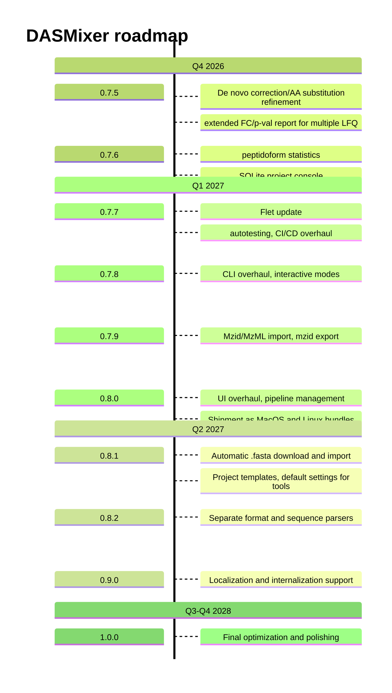

# DASMixer

**DASMixer** is a cross-platform desktop application for integrating and comparing peptide identification data from mass spectrometry experiments. It merges de novo sequencing results with library search identifications, performs full comparative proteomics workflows, and produces publication-ready reports.

Developed at the **Laboratory of Structural Proteomics, IBMC, Moscow**.


---

## Key Features

### Data Loading
- Import spectra in **MGF** format
- Import peptide identifications from **PowerNovo 2**, **MaxQuant**, **PLGS**
- Manage multiple spectra files and identification files per project
- Assign samples to comparison groups (subsets) for differential analysis
- Multi-file batch import via file-pattern matching (CLI & GUI)

### Peptide-Level Processing
- Merge and evaluate identifications across tools
- Set thresholds: PPM error, score, intensity coverage, sequence length, peak counts
- Calculate **ion coverage** (a, b, c, x, y, z ion types) with water/ammonia loss ions
- Automatic **best-charge and isotope-offset correction** for de novo sequences (SeqFixer)
- Select preferred identification per spectrum (by PPM or intensity coverage)
- Interactive **ion annotation plots** via Plotly + PyWebView

### Protein-Level Processing
- Map peptides to proteins via **npysearch BLAST-like search** (FASTA)
- Support for partial sequence matches (de novo identifications)
- Compute **sequence coverage** per protein per sample
- **LFQ quantification**: emPAI, iBAQ, NSAF, Top3 (via semPAI)
- UniProt data enrichment (via uniprot-meta-tool)

### Reports and Export
- Built-in reports: PCA, Volcano, UpSet, Coverage, Tool Match, Sample Summary
- Interactive preview in PyWebView
- Export to **HTML**, **DOCX**, **XLSX** formats
- Saved plots with configurable dimensions and font sizes
- Report history stored in project file

### Plugin System
- Install custom identification parsers (`.py` or `.zip`)
- Install custom report modules
- Manage plugins via GUI Plugins panel

## Documetation

**Read the full documentation at GitHub pages**: [https://protdb.github.io/dasmixer/](https://protdb.github.io/dasmixer/) 

## Packages

The project is split into four PyPI packages:

| Package | Contents | PyPI |
|---|---|---|
| `dasmixer-core` | API, calculations, data import (`dasmixer.api`, `dasmixer.utils`) | `dasmixer-core` |
| `dasmixer-gui` | Flet GUI (`dasmixer.gui`) | `dasmixer-gui` |
| `dasmixer-cli` | CLI tools (`dasmixer.cli`) | `dasmixer-cli` |
| `dasmixer` | Metapackage (all three above) | `dasmixer` |


---

---

## Installation

### Windows installer:

You can get Windows installer from the [**latest GitHub Release**](https://github.com/protdb/dasmixer/releases/latest). Find the DASMixerX.Y.Z-setup.exe file in Assets section, download it and run:


### Full install via pip

```bash
pip install dasmixer
```

### Partial install

```bash
pip install dasmixer-cli               # CLI only
pip install dasmixer-gui               # GUI only
pip install dasmixer-core              # Library only
pip install "dasmixer-core[plotly]"    # Core + Plotly/Kaleido
pip install "dasmixer-core[proteins]"  # Core + npysearch
pip install "dasmixer-core[all]"       # Core + all optional extras
```

### Development

The repo is a **Poetry workspace** of four PEP 420 namespace packages (`dasmixer-core`, `dasmixer-gui`, `dasmixer-cli`, `metapackage`). For local development you run directly from source in editable mode — no build step.

**Requirements:** Python ≥ 3.11, Poetry 2.x.

**Prerequisites — SQLite dev headers.** The project database runs on `aiosqlite`, which requires CPython to be built with the `_sqlite3` module. If your Python was compiled without it, install the headers and rebuild Python:

```bash
sudo apt install libsqlite3-dev        # Debian/Ubuntu
# brew install sqlite                   # macOS (usually already present)
# Windows: SQLite is bundled with official CPython builds
python -c "import sqlite3"             # verify; if it fails, rebuild Python
# pyenv users: pyenv uninstall 3.14.7 && pyenv install 3.14.7
```

**Setup — editable install in the poetry venv.**

Install `dasmixer-core`, `dasmixer-gui`, `dasmixer-cli` as editable. Do **not** install the `metapackage` editable: its `dasmixer/__init__.py` turns `dasmixer` into a regular package and breaks PEP 420 namespace merging of the three `src/dasmixer/` source trees, so `dasmixer.api` / `dasmixer.gui` / `dasmixer.cli` would stop resolving.

```bash
git clone git@github.com:protdb/dasmixer.git
cd dasmixer
poetry run pip install -e "dasmixer-core[all]" -e "dasmixer-gui" -e "dasmixer-cli"
```

**Run from source.** Always launch via `poetry run` so the poetry-venv entry points are used rather than any system-installed `dasmixer`:

```bash
poetry run dasmixer                     # GUI
poetry run dasmixer-cli --help          # CLI
```

Code edits are picked up immediately — no rebuild needed.

**Notes**
- Version: read `from dasmixer.versions import APP_VERSION`. `dasmixer.__version__` is unavailable when the metapackage is not installed (this is expected).
- `make dev-install` installs into the *currently active* environment, not necessarily the poetry venv. Prefer the `poetry run pip install -e ...` form above for poetry-based workflows.

#### Dependency updates

Each subpackage owns its dependencies in its own `pyproject.toml` (`[project] dependencies`). The root `poetry.lock` tracks only shared dev tools (pytest) — it does **not** lock subpackage dependencies. Subpackages are editable-installed via `pip`, so dependency changes require a reinstall to take effect in the venv.

**1. Update the constraint in the subpackage.** Edit `dasmixer-<pkg>/pyproject.toml`, following the existing `>=X.Y.Z,<MAJOR.0.0` range convention.

**2. Reinstall in the root poetry venv.**

```bash
poetry run pip install -e ./dasmixer-core          # reinstall + upgrade changed deps
poetry run pip install -e ./dasmixer-cli -e ./dasmixer-gui   # sync versions
poetry run pip check                               # verify no conflicts
```

**3. Update the GUI standalone env** (has its own `poetry.lock` and venv, with `dasmixer-core` as a path dependency):

```bash
cd dasmixer-gui
poetry lock            # re-resolve lock with the new constraint from ../dasmixer-core
poetry install         # upgrade in the GUI venv
```

For a targeted upgrade of a single package without touching the rest: `poetry update <package>`.

**4. Verify.**

```bash
poetry run python -c "import importlib.metadata as m; print(m.version('<package>'))"
```

## Development roadmap



---

## Architecture

| Layer | Technology |
|---|---|
| GUI | Flet 0.80.5 |
| CLI | Typer |
| Interactive plots | Plotly + PyWebView |
| Data processing | Pandas, NumPy |
| Proteomics | Pyteomics, Peptacular, Npysearch |
| Project storage | SQLite (aiosqlite, async) |
| Configuration | Pydantic-settings |
| Export | openpyxl, html-for-docx, Kaleido |
| Build | Poetry |

---

Copyright © Laboratory of Structural Proteomics, IBMC, Moscow. All rights reserved.