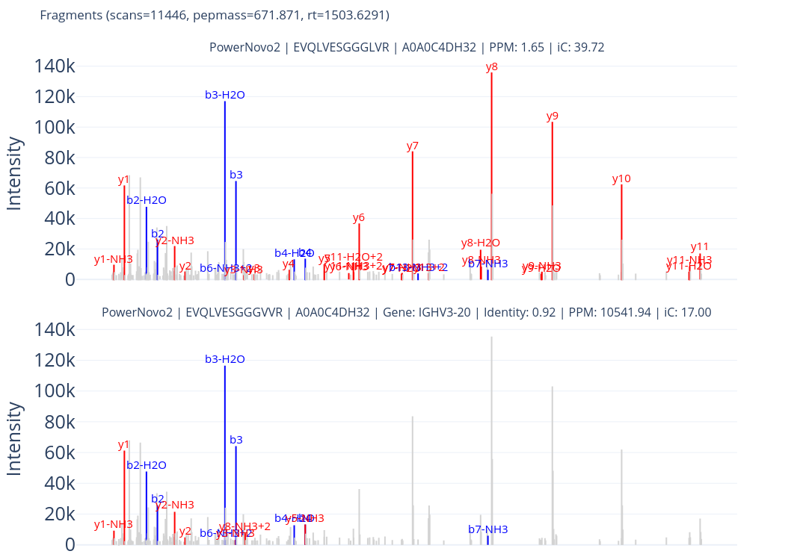

# Core concepts and formulas

This note is important to avoid misunderstandings in terms used in DASMixer as they may not match any other terminology used by other proteomics software.

## Tool

An instrument used to identify peptide sequences from spectre. Can be created by user and
represents some source of Identifications (see below). Uses parser (or "importer") to parse input data format and
transform it to internal representation of identification

## Sample

Proteomic sample of any source. Samples are created authomatically based on input spectra files. However single sample can contain more than one spectre file.

Features from two spectre files in the same Sample are directly combined, so it is not recommended to upload technical/biological repeats as different spectre files of the same sample. Consider using it for cases of fractioning or split processing.

## Specre

Spectre for DASMixer is a single set of Mz and intensity values for a single precursor. Identifications must be matched to the precursor spectre to be calculatable and stored in the DASMixer project.

## Identification

Identification (widely known as PSM, peptide spectra match) is a peptide sequence matched to the Spectre using search engine and imported in DASMixer.

Identification is basically described with:

- Tool used to get this identification
- Peptide sequence in two forms:
  - `sequence` with described PTMs in [HuPO ProForma notation](https://github.com/HUPO-PSI/ProForma) with priority to named PTM form like `[Phospho]` or `[Deamidated]` instead of unreadable `[UNIMOD:7]` 
  - `canonical sequence` with only canonical amino acids
- search engine score
- physical PSM characteristics

## Identification properties

DASMixer does not implement False Discovery statistical protocol. Instead, it calculates peptide fragmentation and analyze how it is mapped to the spectre.

Identifications mapping process performed with "Calculate Ion coverage" action. However, Ion Coverage is not the only one parameter calculating in this process.

These criteria follows:

### Intensity Coverage, %

Percent of total intensity of peacs in spectre to peaks associated with fragments.

$$Ic = \frac{\sum_{mz=0}^n i_{frag}}{\sum_{mz=0}^n i_{all}}*100$$

### PPM

Precursor error in parts per million, PPM error. Difference between precursor mass from spectre and theoretical mass of the identified sequence regarding PTMs and charge

$$PPM = \frac{Pepmass - MZ_{theor}}{MZ_{theor}} * 1e6$$

Where \(Pepmass\) is precursor mass reported along with spectra and \(MZ_{theor}\) calculated as follows:

$$MZ_{theor} = \frac{Mass_n + Charge * Proton}{Charge}$$

Where:

* \(Mass_n\) is neutral monoisotopic mass of sequence with PTMs
* \(Charge\) is precursor charge
* \(Proton\) is a single proton mass constant (`1.007276`)

### Peaks covered, top peaks

Number of peaks matched to ions. peaks covered is a simple metrics of how many fragments get matched to experimental spectra. Top peaks calculated as number of top-10 experimental spectra peaks matched to the fragments

### Quality

Identification quality is an index of ions matched to the spectra. Based on:

> Bern, M., Goldberg, D., McDonald, W. H., & Yates, J. R. (2004).
> *Automatic Quality Assessment of Peptide Tandem Mass Spectra.*
> **Bioinformatics**, 20(suppl_1), i49–i54.
> https://doi.org/10.1093/bioinformatics/bth947

$$Q = \frac{1}{N_{types}} * \frac{N_{match}}{L - 1}$$

Where:

* \(N_{types}\) is number of ion types selected (2 if only _b_ and _y_ ions selected; up to 6 for a, b, c, x, y, and z)
* \(N_{match}\) is number of unique ion matched. This value intentionnaly eexclude duplicates of fragment variations by charges and losses: y6, y6++ and y6-NH3 will count as single found fragment
* \(L\) is length of peptide sequence.

### Longest Consequtive Run Ratio (LCRR)

An indicator of longest sequence of fragment ions found in the spectre and divided by sequence lenght. Can be described better by example:

Let's say, for a peptide consists of 10 amino acids, there are following fragments mapped to the experimental spectra:

```
y2, y3, y3++, y4-NH3, y6, y7, y9, b2, b4, b5, b7
```

LCRR value in this case will be equal to `0.3` as the longest conequtive run is of lenght 3 (`y2, y3, y4`) and peptide length is 10. y3 and y3++ considered as a single ion
(like Quality calculation described above) and y5 is missing.

### Unconfirmed PTMs

>**Note**: described logic is subject of refinement in further versions

Number of PTMs present in identification but not confirmed by fragmentation.

The fragment of the spectre corresponds to a partial sequence of the whole precursor peptide. As sequence is partial, it is common when overall fine covered sequence has no ion with sequence including one or more PTMs.

$$Unconfirmed = PTM(peptide) - \max_{i}(PTM({fragment_i}))$$

where _fragment_ is fragment sequence, peptide is peptide sequence and PTM is function to calculate PTMs from ProForma record

## Spectre and identification correction

There are common problems with spectre metadata and sequence annotation that DASMixer tries to fix when calculating ion coverage:

1. wrong or absent precursor charge of the spectra
2. precursor mass error based on isotope offset
3. fixed PTMs considered by search engine but not reported in sequence
4. unlocalized PTMs (especially common for PLGS)

first two points can result in significant difference in theoretical and experimental precursor masses while 3rd and 4th affect fragment mapping.

DASMixer will try to:
- minimize precursor PPM error iterating over charges and, for charge resulting in minimum absolute PPM, shifting mass for isotope offset;
- recombinate PTMs in sequence to reach reasonable PPM error without decreasing intensity coverage

These steps are inkluded in pipeline by default yet can be easily omitted.

## Preferred identifications

Preferred identification is one of the most important concepts of DASMixer workflow and at the same time requires some effort to be understood.

It is obvious that not every identification can be trusted, especially if it is prodused by de novo search engine.
Instead of calculating its own score or FDR value, DASMixer operates with set of criteria (described above) and user-defined thresholds for these criteria.
Also while every identification is linked to the spectre, it is also important to not duplicate identifications used to estimate proteins abundance in sample.
Preferred identification concept aimed to solve these two problems.

Identification can be considered preferred only if all its indicators passes thresholds set by user.
If two or more identification of a single spectre passed thresholds, only the best one can be selected as preferred.
If identifications are identical, preferred flag is set to first tool in list
(it is not important when we speak about protein identification, however these identifications counted in Tool match report as found by "Both" tools).

**In short**: preferred identification is an identification that passes treshold of physical criteria for the tool and is better in spectre explanation than other identifications for this spectra.

Only preferred identifications are used to determine protein abundance. 
But preferred identifications not matched to the proteins can be additional point of interest representing unknown proteoforms
or elements of peptidome. However, we recommend to thoroughly review such findings.  

## Protein matching

For database search engines all the imported identifications are peptides taken from known proteins in proteome, while de novo search tools often provide only sequence without mapping to the proteins.
DASMixer provides the tool to search identification sequences in user-provided proteome (via .fasta file upload).
Uploading proteome to DASMixer is also useful if you are working with DB search only as identification data does not provide full protein sequences required to calculate protein coverage and theoretical peptides for LFQ.

Protein matching is performed using npysearch library:

> Schmid S, Jeevannavar A, Julian TR, Tamminen M (2023) 
> Portable BLAST-like algorithm library and its implementations 
> for command line, Python, and R. PLoS ONE 18(11): e0289693. 
> https://doi.org/10.1371/journal.pone.0289693

Protein matching process is mandatory in pipeline, however for database search results it can just load proteins provided with identifications to project. This process is quite more important for de novo and open search scenarios.

### Protein identity

Identity is a lower limit of match between identification sequence and most similar fragment in protein database. Identity can be in 0...1 interval where 1.0 is 100% match and 0.0 is just any aminoacid sequence.

### De Novo correction

DASMixer offers a de novo correction scenario to fix some portion of de novo sequencing errors. In this case, you should lower the _protein identity_ setting and enable _de novo correction_ mode for tool.

In that case, DASMixer searches peptides in protein database with difference until given identity. For de novo correction it is recommended to use identity in 0.7-0.8 interval.

The closest sequence found in protein database is called `matched sequence`. If identifications canonical sequence and matched sequence are not identical, DASMixer validates matched sequence against the experimental spectra:
- calculates PPM difference.
- calculates ion coverage with application of source PTMs. If PTM sites differs between sequence and matched sequence, DASMixer tries to re-allocate PTMs the same way it does for Ion matching

If ppm error and intensity coverage of matched sequence is not worse than the same indicators of original sequence, protein match is saved to the project.

If source sequence does not fit to preferred criteria while matched sequence does, DASMixer can consider this identification as preferred.

### Amino Acid substitutions

DASMixer can analyze if de novo identification contains potential amino acid substitution (AA substitution). AA substitution search is based on the same calculations that de novo correction, but relies on differen outcome.

AA substitution is suspected when: source sequence is fine enough to be considered preferred identification but protein match is not exact (identity < 1.0) and matched sequence has no better indicators of ppm and intensity coverage.
In other words, sequence contains AA substitution if it slightly differs from canonical protein sequence but offers better explanation of the experimental spectre. You can see the example below:



> AA substitution ion coverage example. First: fragmentation plot for sequence fond using PowerNovo2. Second: plot for matched sequence with identity=0.92. 
> minor sequence changes results in loss of almost every y ion, significant PPM error increase and decrease of intensity coverage (iC)

**Note:** AA substitution search algorithm is experimental and can be subject of refinement in future versions of DASMixer.
Correlation between de novo detected AA substitution and genetic mutations is not confirmed yet by proper publications.
We recommend to thoroughly review AA substitution data presented by DASMixer before any conclusions are made.

### Unique evidences

If sequence is found in one and only one protein in database, it is considered as unique evidence of protein existence in sample.

## Protein identifications

Based on list of preferred identifications matched to proteins, DASMixer creates a list of proteins in sample. Default limits to add protein in list are:
- two identifications minimum
- at least single unique evidence

These filters can be bypassed or strenghtened by user.

### Label-free quantification

Label-free quantification (LFQ) is a set of approaches to estimate proteins proportion in complex mixture of the sample.
DASMixer offers four different approaches to calculate LFQ and also two approaches to normalize these values by orthogonally calculated value. Methods described in details on [Separate page](lfq.md)