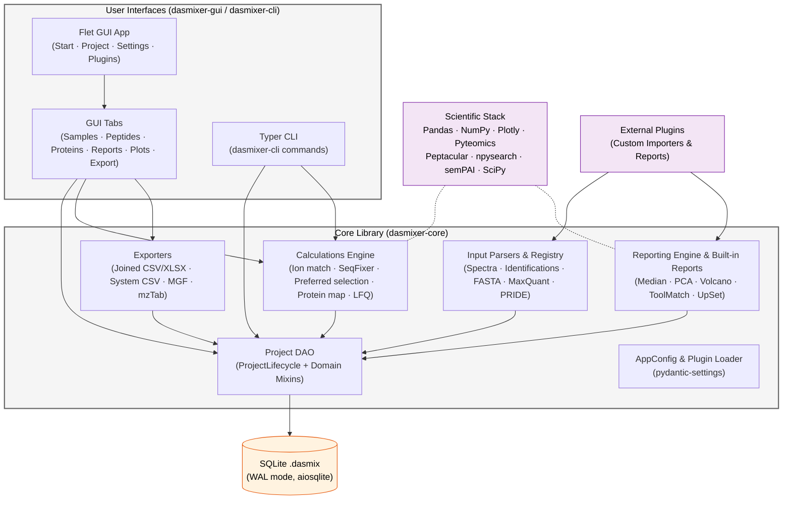

# Modules and Architecture

DASMixer is designed as a modular Python monorepo using **PEP 420 namespace packages**. This architecture cleanly separates the headless proteomics calculation and storage engine (`dasmixer-core`) from the graphical user interface (`dasmixer-gui`) and command-line interface (`dasmixer-cli`).

If you want to embed DASMixer into your own bioinformatics pipelines, Jupyter notebooks, or web backends, you can depend solely on `dasmixer-core` without pulling in GUI frameworks like Flet or PyWebView.

---

## Package Structure

All four publishable packages install into the shared `dasmixer.*` namespace:

| Package | Namespace Modules | Purpose |
|---|---|---|
| **`dasmixer-core`** | `dasmixer.api`, `dasmixer.reports`, `dasmixer.utils`, `dasmixer.versions` | Core async SQLite project API, file parsers, ion matching, SeqFixer, BLAST protein mapping, LFQ, exporters, and report engine |
| **`dasmixer-gui`** | `dasmixer.gui`, `dasmixer.__main__` | Cross-platform desktop GUI built with Flet and Plotly/PyWebView |
| **`dasmixer-cli`** | `dasmixer.cli` | Typer-based command-line interface (`dasmixer-cli`) |
| **`dasmixer`** *(metapackage)* | `dasmixer` | Umbrella package that installs `core`, `gui`, and `cli` together |

---

## High-Level Architecture Diagram



---

## Core Subpackages (`dasmixer-core`)

### 1. Project Data Access (`dasmixer.api.project`)

The central object in DASMixer is `dasmixer.api.project.project.Project`, an **async-first** data access object backed by `aiosqlite`.

`Project` is composed from focused domain mixins so that each entity type stays isolated:

```
ProjectBase                      # Low-level SQLite execution & JSON/gzip helpers (core/base.py)
  └─ ProjectLifecycle            # Connection init, WAL, save, close, context manager (core/lifecycle.py)
       └─ Project                # Composed facade class (project.py)
            ├─ MigrationMixin          # Schema version upgrades (migrations.py)
            ├─ SubsetMixin             # Comparison groups (mixins/subset_mixin.py)
            ├─ ToolMixin               # Identification tools (mixins/tool_mixin.py)
            ├─ SampleMixin             # Samples and sample statistics (mixins/sample_mixin.py)
            ├─ SpectraMixin            # Spectra files and compressed peak arrays (mixins/spectra_mixin.py)
            ├─ IdentificationMixin     # Identification files and PSM records (mixins/identification_mixin.py)
            ├─ PeptideMixin            # Peptide-to-protein matches (mixins/peptide_mixin.py)
            ├─ JoinedPeptideDataMixin  # Complex joined peptide queries (mixins/joined_peptide_data_mixin.py)
            ├─ ProteinMixin            # Proteins, protein IDs, LFQ results, saved plots (mixins/protein_mixin.py)
            ├─ ImportProjectMixin      # Atomic cross-project merge (mixins/import_project_mixin.py)
            ├─ PlotMixin               # Spectrum and protein plot data preparation (mixins/plot_mixin.py)
            ├─ QueryMixin              # Raw SQL execution returning dicts or DataFrames (mixins/query_mixin.py)
            └─ ReportMixin             # Generated reports and saved report parameters (mixins/report_mixin.py)
```

See [dasmixer-core Library and API](core_api.md) for method signatures and data transfer objects.

### 2. Input Parsers (`dasmixer.api.inputs`)

Handles reading external file formats in asynchronous batches (`AsyncIterator[pd.DataFrame]`):

- `registry` (`dasmixer.api.inputs.registry`) — global singleton `InputTypesRegistry` holding all registered spectral and identification parsers.
- `spectra/` — `SpectralDataParser` base class, `MGFParser` (`MGF`), and `MGFParserPLGS` (`MGF (PLGS Pseudo-DIA)`).
- `peptides/` — `IdentificationParser`, `TableImporter`, `SimpleTableImporter`, `LargeCSVImporter`, and built-in parsers (`PowerNovo2`, `MaxQuant`, `PLGS`, `PeptideShaker XLS`, `mzTab`, `CasaNovo`, `Pi-PrimeNovo`).
- `proteins/fasta.py` — `FastaParser` for reading UniProt and generic FASTA databases.
- `complex/` — orchestrators for multi-file workflows (`maxquant` and `pride`).

### 3. Calculations Engine (`dasmixer.api.calculations`)

Stateless and multiprocessing-ready algorithms for the proteomics workflow:

- `spectra/ion_match.py` — theoretical peptide fragmentation and peak matching via `peptacular` (`IonMatchParameters`, `match_predictions`, `get_matches_dataframe`).
- `spectra/identification_processor.py` — batch worker `process_identifications_batch` computing SeqFixer refinements, PPM, intensity coverage, Quality, LCRR, and unconfirmed PTMs across CPU cores.
- `spectra/plot_matches.py` & `plot_flow.py` — Plotly MS/MS fragmentation spectrum figure builders (`make_full_spectrum_plot`).
- `ppm/seqfixer.py` — `SeqFixer` combinatorial precursor charge, isotope offset, and PTM optimizer.
- `peptides/matching.py` — preferred identification selection (`select_preferred_identifications`, `calculate_preferred_identifications_for_file`).
- `peptides/protein_map.py` — BLAST-like peptide-to-protein alignment via `npysearch` (`map_proteins`), including *de novo* sequence correction and amino acid substitution detection.
- `proteins/map_identifications.py` — sample-level protein inference and sequence coverage (`find_protein_identifications`).
- `proteins/lfq.py` & `proteins/sempai/` — Label-Free Quantification (`calculate_lfq`) supporting `emPAI`, `iBAQ`, `NSAF`, and `Top3` with optional absolute concentration calibration.

### 4. Reporting Engine (`dasmixer.api.reporting` & `dasmixer.reports`)

- `dasmixer.api.reporting.base.BaseReport` — abstract base class handling parameter validation, report generation, database serialization, Jinja2 HTML rendering, and export to `.html`, `.docx`, and `.xlsx`.
- `dasmixer.api.reporting.registry.registry` — global `ReportRegistry` singleton.
- `dasmixer.reports.*` — built-in report packages (`median_report`, `pca_report`, `volcano_report`, `toolmatch_report`, `upset_report`). Each report package separates its core logic (`report.py`, `params.py`) from its optional Flet GUI form (`form.py`, imported under a `try/except ImportError` guard) so reports work seamlessly with or without `dasmixer-gui` installed.

### 5. Exporters (`dasmixer.api.export`)

Programmatic export functions matching the GUI's **Export** tab:

- `joined_export.export_joined_data()`
- `system_export.export_system_data()`
- `mgf_export.export_mgf()`
- `mztab_export.export_mztab()`

### 6. Configuration & Plugin Loader (`dasmixer.api.config`, `dasmixer.api.plugin_loader`)

- `AppConfig` — `pydantic-settings` model managing user preferences in `{app_dir}/config.json`.
- `plugin_loader` — discovers and dynamically imports `.py` and `.zip` plugins from `{app_dir}/plugins/inputs/identifications/` and `{app_dir}/plugins/reports/`.
