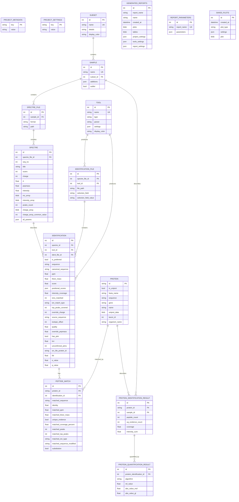

# Project File Structure (`.dasmix`)

A DASMixer project file (`.dasmix`) is a self-contained **SQLite 3** database operating in Write-Ahead Logging (**WAL**) mode with foreign key constraints enforced (`PRAGMA foreign_keys = ON`).

Because it is a standard SQLite file, you can inspect or query it directly using `dasmixer-core`, Python's built-in `sqlite3` module, or any database viewer (such as DBeaver or DB Browser for SQLite).

---

## Entity-Relationship Diagram



---

## Binary and JSON Encoding Conventions

### NumPy Arrays (`spectre` table)

Peak lists (`mz_array`, `intensity_array`, `charge_array`) are compressed into `BLOB` columns using `np.savez_compressed`. To read or write them in Python, use the helper functions in `dasmixer.api.project.array_utils`:

```python
from dasmixer.api.project.array_utils import compress_array, decompress_array

blob: bytes = compress_array(mz_numpy_array)
mz_numpy_array = decompress_array(blob)
```

### Pickled Objects (`protein`, `generated_reports`, `saved_plots`)

Complex Python objects (`uniprot_data`, report `plots` and `tables`, and `saved_plots.plot`) are serialized with `pickle.dumps()` and compressed with `gzip.compress()`.

### JSON Columns

SQLite `TEXT` columns are used for structured dictionaries and lists (`tool.settings`, `sample.additions`, `spectre.all_params`, `identification.positional_scores`, and settings snapshots in `generated_reports`). They are serialized with standard `json.dumps()` and `json.loads()`.

---

## Portability and WAL Files

While a project is open, SQLite creates two companion files alongside `project.dasmix`:

- `project.dasmix-wal` (Write-Ahead Log)
- `project.dasmix-shm` (Shared Memory index)

When `project.close()` or `project.save(checkpoint=True)` is called (or via `dasmixer-cli checkpoint project.dasmix`), all transactions from the `-wal` file are merged into the main `.dasmix` file, making it safe to copy or share as a single file.
