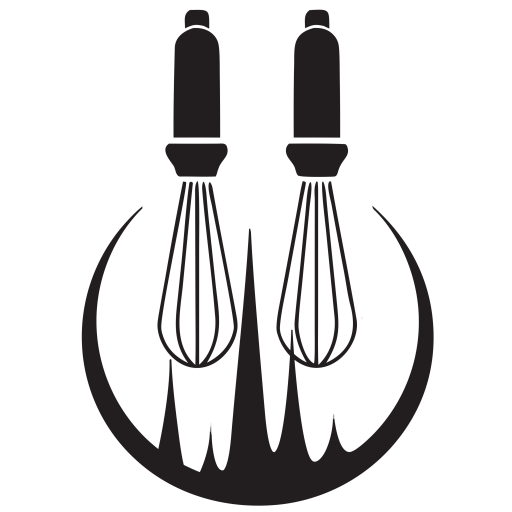

# DASMixer user guide

**DASMixer** is a cross-platform desktop application for integrating and comparing peptide identification data from mass spectrometry experiments. It merges de novo sequencing results with library search identifications, performs full comparative proteomics workflows, and produces publication-ready reports.

Developed at the **Laboratory of Structural Proteomics, IBMC, Moscow**.

