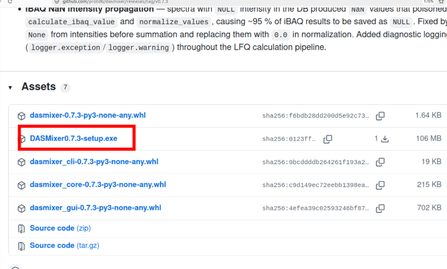

# DASMixer installation

## Windows

You can get the latest release from [**GitHub Releases**](https://github.com/protdb/dasmixer/releases/latest).

Under the changelog in files section find the DASMixerX.X.X-setup.exe as shown below:



Follow the installation steps. DASMixer will be available to run as common desktop application and will be accessible via Start menu.

DASmixer project files .dasmix will also be associated with DASmixer app.

## Install as python package (other systems)

DASMixer can be installed as python package from PyPi repository:

```shell
pip install dasmixer
```

Alternatively, you can install CLI-mode only:

```shell
pip install dasmixer-cli
```

### Use Conda environment

DASMixer cannot be installed via Conda, but you can use COnda to create isolated environment. **Recommended** in older systems as DASmixer works best on Python 3.14

```shell
conda create -n dasmixer python=3.14 -y
conda activate dasmixer
pip install dasmixer
```

Pip installation can encounter some problems with dependency build. It can be easily solved using google search for missing system packages like libraries and compilers.