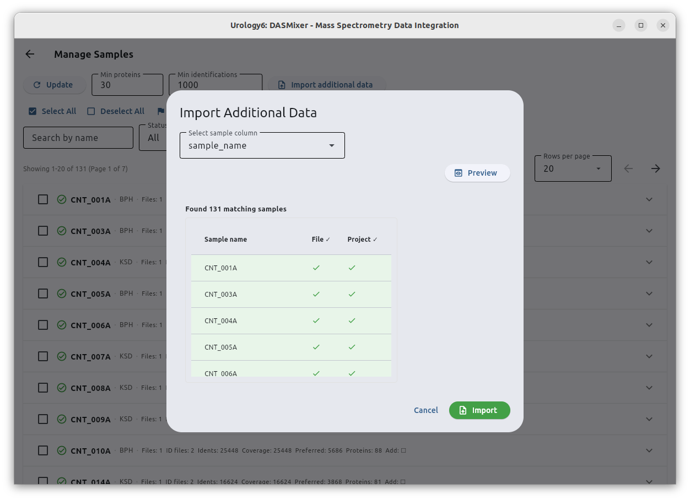
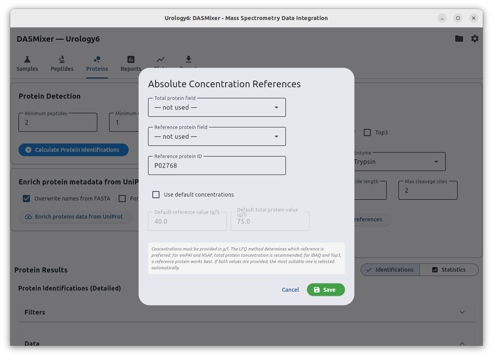

# Absolute Concentrations Settings

In addition to relative Label-Free Quantification (where protein abundances in each sample are normalized to sum to `1.0`), DASMixer can calibrate LFQ results into **absolute mass concentrations ($\text{g/L}$)** and **molar concentrations ($\text{mol/L}$)**.

Absolute calibration is based on either (or both) of two orthogonal reference values measured for your samples:

1. **Total protein concentration** (in $\text{g/L}$, e.g., measured via Bradford or BCA assay)
2. **Reference protein concentration** (in $\text{g/L}$, e.g., a spiked-in internal standard or a known endogenous protein such as human serum albumin, `P02768`, measured by clinical assay)

For the mathematical formulas used to compute absolute mass and molar concentrations, see [LFQ Methods — Absolute Quantification](../../lfq.md#absolute-quantification).

---

## Step 1: Import Sample Concentration Metadata (Optional)

If you have measured per-sample total protein or reference protein concentrations, you can attach those values to your samples as **Additional Sample Data**:

1. Prepare a **CSV** or **XLSX** spreadsheet containing a column with your sample names (matching the sample names in your DASMixer project) and one or more numeric columns with concentration values in **$\text{g/L}$** (for example, `total_protein` and `albumin`).
2. Open the **Samples** tab and click **Manage Samples**.
3. In the top bar of the *Manage Samples* view, click **Import Additional Data**.
4. Select your `.csv` or `.xlsx` file in the file picker.
5. In the **Import Additional Data** dialog:
   - Choose the column that contains your **Sample names** from the dropdown.
   - Click **Preview** to verify the sample intersection table:
     - **Green rows** exist in both your file and the project and will be updated.
     - **Yellow rows** exist only in the project.
     - **Red rows** exist only in the file.
   - Click **Import** to merge the additional fields into your project samples.

{data-description="Import Additional Data dialog — map a CSV/XLSX column to sample names and preview the intersection."}

> **Alternative:** You can also edit a single sample's additional metadata manually by clicking the **Edit** (pencil) button on its panel in **Manage Samples**, or use constant default concentrations for all samples (see Step 2 below).

---

## Step 2: Configure Absolute Concentration References

Once your sample metadata is imported (or if you want to use constant default values across all samples):

1. Switch to the **Proteins** tab.
2. In the **Label-Free Quantification** card, check **Abs. concentrations** and click **Set references**.
3. The **Absolute Concentration References** dialog opens:

{data-description="Absolute Concentration References dialog — configure reference protein, total protein field, and default fallback values."}

Configure the following options:

| Field | Default | Description |
|---|---|---|
| **Total protein field** | `— not used —` | Select the sample metadata key (from Step 1) that stores total protein concentration in $\text{g/L}$. |
| **Reference protein field** | `— not used —` | Select the sample metadata key that stores the reference protein's concentration in $\text{g/L}$. |
| **Reference protein ID** | `P02768` | The UniProt accession (or FASTA protein ID) of the reference protein in your database (`P02768` is Human Serum Albumin). |
| **Use default concentrations** | Off | When checked, DASMixer uses fallback constant values whenever a sample lacks per-sample metadata (or if no metadata fields are selected). |
| **Default reference value (g/l)** | `40.0` | Fallback concentration for the reference protein in $\text{g/L}$ (typical human plasma albumin concentration). |
| **Default total protein value (g/l)** | `75.0` | Fallback total protein concentration in $\text{g/L}$ (typical human plasma total protein concentration). |

4. Click **Save** to store your reference configuration in the project.

> **How DASMixer chooses the reference:**
> All input concentrations must be in **$\text{g/L}$**. Different LFQ algorithms pair naturally with different calibration strategies:
> - For **emPAI** and **NSAF**, **total protein concentration** is preferred.
> - For **iBAQ** and **Top3**, a **reference protein** (internal standard) works best.
> - If both values are available for a sample, DASMixer automatically applies the appropriate calibration strategy.

---

## Step 3: Calculate LFQ and View Absolute Concentrations

1. On the **Proteins** tab, ensure the **Abs. concentrations** checkbox is checked.
2. Select your desired LFQ methods (`emPAI`, `iBAQ`, `NSAF`, `Top3`) and click **Calculate LFQ**.
3. Once calculation completes, both `abs_value_gl` ($\text{g/L}$) and `abs_value_mol` ($\text{mol/L}$) are stored alongside the relative LFQ value (`rel_value`) for every quantified protein.

You can then use absolute concentrations throughout DASMixer:

- **Proteins table:** Enable the absolute concentration columns (`emPAI (g/L)`, `emPAI (mol/L)`, etc.) via the column selector (**⚙️**) in the Identifications table.
- **Protein abundance plots:** In **Plot settings** on the Proteins tab, switch **Value type** to `Absolute (g/L)` or `Absolute (mol/L)` and select your preferred unit multiplier ($\text{g/L}$, $\text{mg/L}$, $\mu\text{g/L}$, $\text{ng/L}$, $\text{mol/L}$, $\text{mmol/L}$, $\mu\text{mol/L}$, $\text{nmol/L}$).
- **Reports:** In the **Basic statistics**, **PCA & ROC-AUC**, and **Volcano** report parameter dialogs, choose `abs_value_gl` or `abs_value_mol` in the LFQ selector.
