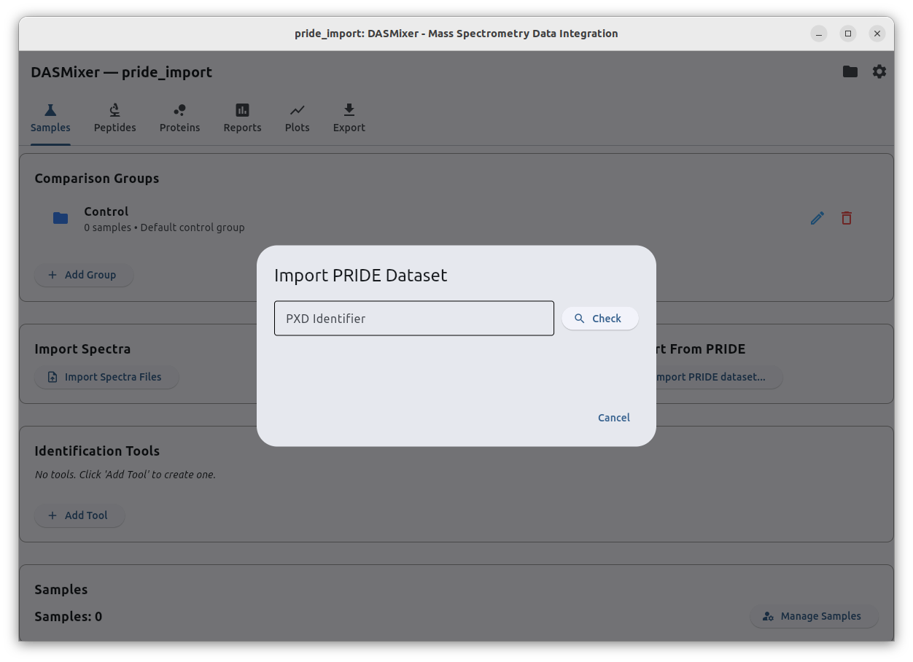
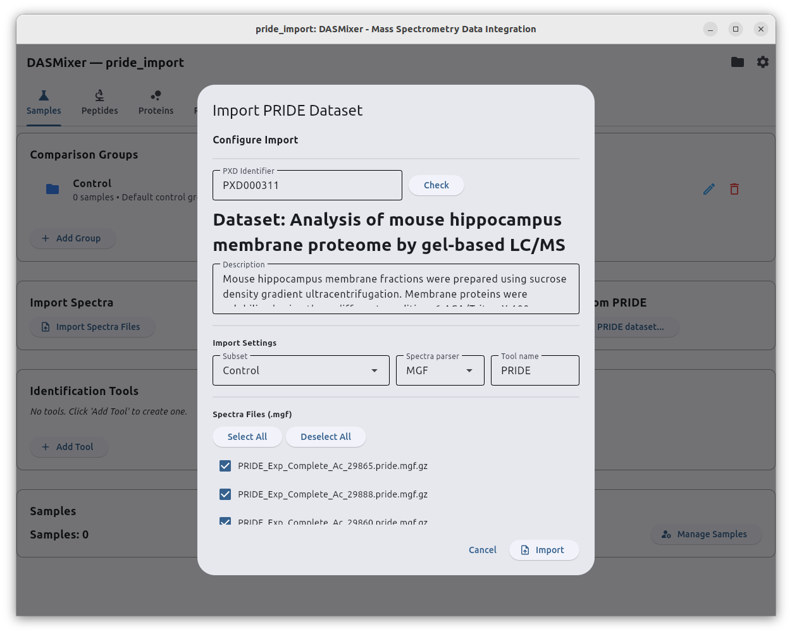
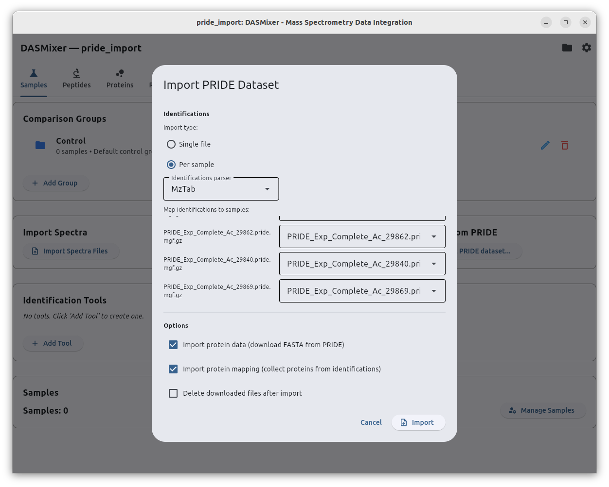

# PRIDE Dataset Import

DASMixer can query the public [**PRIDE Archive**](https://www.ebi.ac.uk/pride/) directly by dataset accession (`PXD...`), download supported spectral (`.mgf`), identification (`.mzTab` or CasaNovo), and protein database (`.fasta`) files, and import them into your project through a guided wizard or a single CLI command.

---

## Prerequisites

PRIDE dataset import relies on the `pridepy` library.

- **Windows standalone installer:** Included out of the box.
- **Python / `pip` installation:** Ensure the `pride` extra is installed:
  ```shell
  pip install "dasmixer-core[pride]"
  ```

An active internet connection is required to query PRIDE metadata and download dataset files.

> **Supported file formats in PRIDE:**
> A PRIDE submission must contain at least one `.mgf` peak-list file and at least one supported identification file (`.mztab` or CasaNovo output) to be imported automatically. Raw vendor files (`.raw`, `.d`, `.wiff`) without companion `.mgf` peak lists cannot be imported directly.

---

## GUI Import Wizard

### Step 1: Enter the PXD Identifier

1. Open your project and stay on the **Samples** tab.
2. In the **Import From PRIDE** section, click **Import From PRIDE…**.
3. Enter the ProteomeXchange accession (for example, `PXD000001`) into the **PXD Identifier** field and click **Check**.

{data-description="Step 1 — enter a PRIDE PXD accession and click Check."}

DASMixer queries the PRIDE REST API in the background and retrieves the dataset's title, description, and file list.

---

### Step 2: Configure the Import

Once the dataset metadata loads, the wizard advances to the **Configure Import** screen:

{data-description="Step 2 — review dataset info, select subset, choose parsers, and configure spectra files."}

{data-description="Step 2 continued — identification file mapping and protein import options."}

Review and configure the following sections:

#### Dataset Info
Displays the dataset title and abstract from PRIDE. You can also type a different `PXD` accession at the top and click **Check** to switch datasets without closing the dialog.

#### Import Settings
- **Subset:** Select which comparison group in your project will receive the imported samples.
- **Spectra parser:** Format parser for the spectral files (`MGF` by default, or `MGF (PLGS Pseudo-DIA)`).
- **Tool name:** Name of the identification tool to create or reuse in your project (default: `PRIDE`).

#### Spectra Files (`.mgf`)
Lists all `.mgf` files discovered in the PRIDE dataset. All files are checked by default; uncheck any files you want to skip, or use **Select All** / **Deselect All**. Each selected MGF file will create (or update) a corresponding sample in the chosen subset.

#### Identifications
Choose how identification files in the dataset relate to the spectral files:

- **Single file:** One combined identification file (`.mzTab`) contains results for all spectral files in the dataset. Select the file from the **Identification file** dropdown.
- **Per sample:** Each spectral file has its own companion identification file (`.mzTab` or `CasaNovo`). A mapping table is displayed where DASMixer automatically pairs each MGF file with the identification file sharing the same filename stem; you can adjust any dropdown manually.

#### Options
- **Import protein data (download FASTA from PRIDE):** Enabled by default. If the PRIDE submission includes a `.fasta` file, DASMixer downloads and imports the protein sequences into the project.
- **Import protein mapping (collect proteins from identifications):** Enabled by default (when using `mzTab`). Extracts protein accessions directly from the identification file.
- **Delete downloaded files after import:** Off by default. Downloaded PRIDE files are cached under your configured temporary directory (`{large_file_tempdir}/pride/<PXD_ID>/`). Check this box if you want DASMixer to delete the downloaded files once the import finishes.

---

### Step 3: Run Download and Import

Click **Import**. The wizard switches to a progress screen showing download and database import stages for each file. Once finished, the dialog closes and a green notification summarizes the imported samples, spectra, and identifications.

---

## CLI Import

You can also import a PRIDE dataset from the terminal using `dasmixer-cli`:

```bash
dasmixer-cli import pride PROJECT_PATH DATASET_ID [OPTIONS]
```

If `PROJECT_PATH` does not exist yet, a new `.dasmix` project is created automatically.

### Arguments and Options

| Argument / Option | Default | Description |
|---|---|---|
| `PROJECT_PATH` | *(required)* | Path to the `.dasmix` project file (created if missing) |
| `DATASET_ID` | *(required)* | PRIDE accession, e.g., `PXD000001` |
| `--tool-name` | `PRIDE Import` | Name of the identification tool in the project |
| `--subset-name` | `PRIDE Import` | Comparison group name for imported samples |
| `--spectra-parser` | `MGF` | Registered spectra parser name (`MGF` or `MGF (PLGS Pseudo-DIA)`) |
| `--ident-parser` | `mzTab` | Registered identification parser (`mzTab` or `CasaNovo`) |
| `--ident-mode` | `single` | `single` (one combined ident file) or `per_sample` (one ident file per MGF) |
| `--import-fasta` / `--no-import-fasta` | `--import-fasta` | Download and import FASTA protein sequences from the dataset |
| `--collect-proteins` / `--no-collect-proteins` | `--collect-proteins` | Collect protein IDs from identification files |
| `--delete-temp-files` / `--keep-temp-files` | `--keep-temp-files` | Delete or keep downloaded files after import |

### Example

```bash
dasmixer-cli import pride ./study.dasmix PXD012345 \
    --subset-name "PRIDE_Cohort" \
    --tool-name "PRIDE_mzTab" \
    --ident-mode single
```
