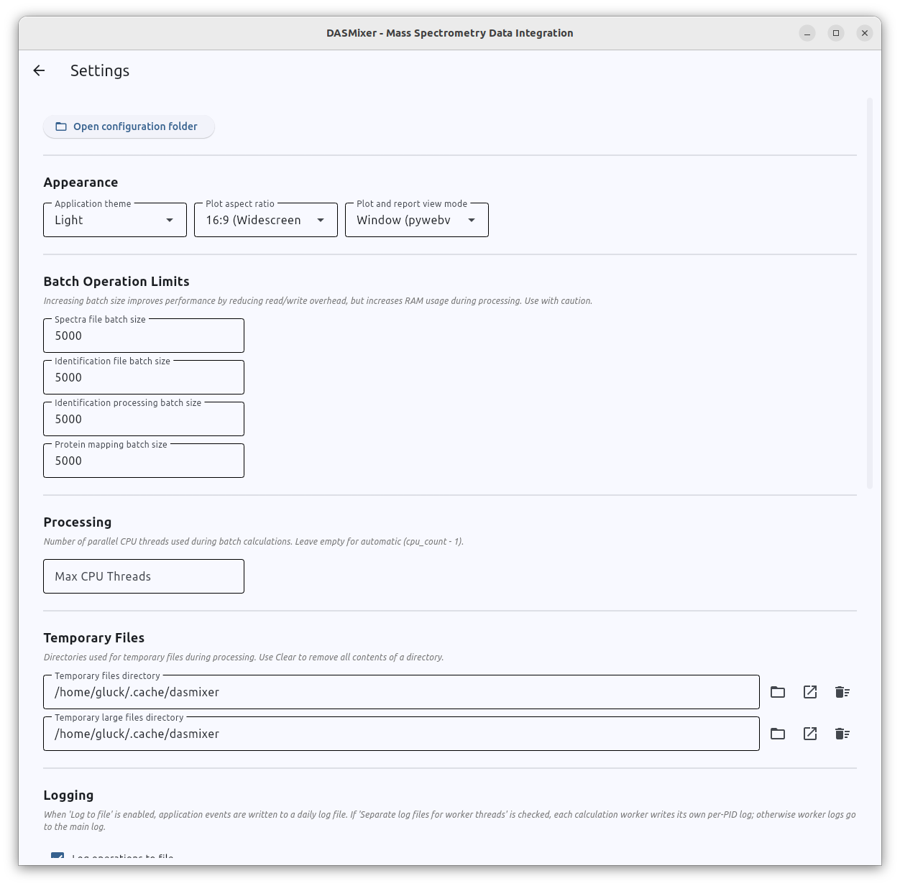
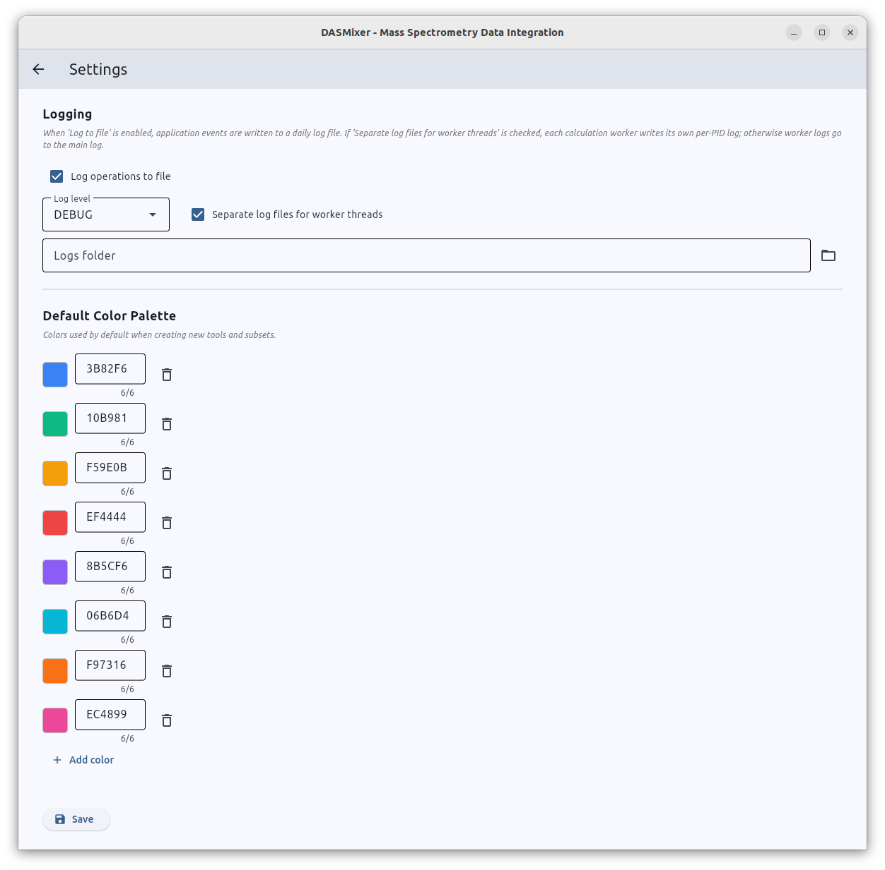
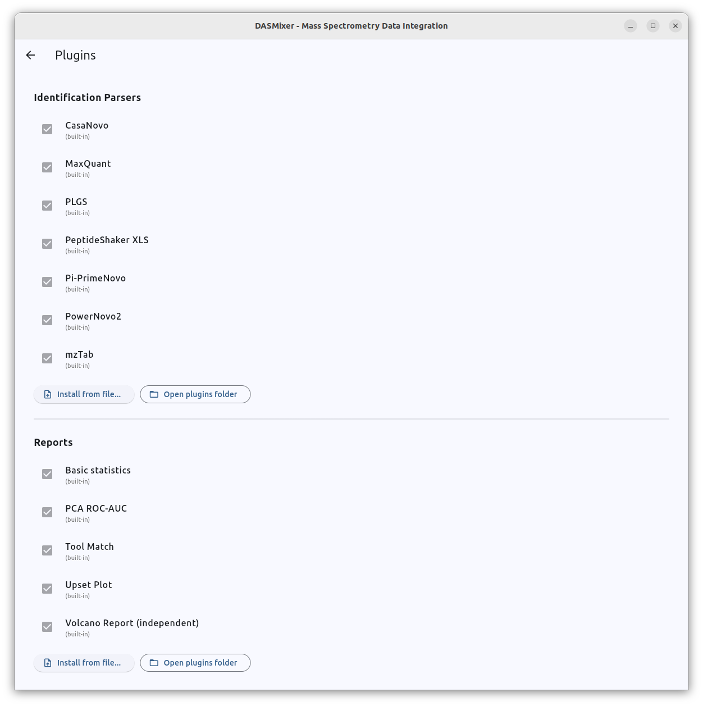

# Settings and Plugins

Application-wide preferences and external plugins are managed from the **Options** menu in the top application bar (available from both the Start screen and the Project view):

- **Options → Settings** — configure appearance, batch sizes, CPU threads, temporary directories, logging, and default color palettes.
- **Options → Plugins** — inspect built-in and external parsers/reports, install new plugins, or enable/disable existing ones.

All application settings are stored in a JSON configuration file (`config.json`) inside your platform's user configuration directory:

| Operating System | Configuration Directory |
|---|---|
| **Linux** | `~/.config/dasmixer/` |
| **Windows** | `%APPDATA%\dasmixer\` |
| **macOS** | `~/Library/Application Support/dasmixer/` |

---

## Application Settings (`Options → Settings`)

{data-description="Application Settings view — Appearance, Batch limits, and Processing sections."}

{data-description="Application Settings view — Temporary files, Logging, Colour Palette, and Actions sections."}

### 1. Appearance

- **Theme:** Switch the user interface between **Light** and **Dark** mode.
- **Plot aspect ratio:** Controls the default width-to-height proportions of generated spectrum and protein plots:
  - `16:9` (Widescreen — default)
  - `4:3` (Classic)
  - `1:1` (Square)
  - `2:3` (Portrait)
- **Plot and report view mode:** Determines how interactive plots and reports are opened when you click **Interactive** or **View**:
  - `Window` (default) — opens an embedded desktop window powered by PyWebView.
  - `Browser` — writes a temporary HTML file and opens it in your system's default web browser. Switch to `Browser` mode if PyWebView windows fail to launch on your OS or display server.

### 2. Batch Operation Limits

Controls how many records DASMixer processes per chunk during database imports and heavy calculations. Larger batch sizes can improve throughput on machines with ample RAM, while smaller batch sizes reduce memory consumption:

- **Spectra file batch size** (default: `5000`) — number of MS/MS spectra inserted per database batch during MGF import.
- **Identification file batch size** (default: `5000`) — number of PSMs inserted per batch during identification import.
- **Identification processing batch size** (default: `5000`) — number of identifications sent per batch to worker processes during **Calculate ion coverage**.
- **Protein mapping batch size** (default: `5000`) — number of sequences aligned per batch during `npysearch` BLAST protein mapping.

> **Memory Warning:** Setting batch sizes above `100,000` will trigger a confirmation warning, as very large batches can consume significant system memory (RAM).

### 3. Processing

- **Max CPU Threads:** Maximum number of parallel worker processes used for multi-core calculations (such as ion coverage and protein mapping). Leave this field empty to let DASMixer automatically use `CPU count - 1` threads.

### 4. Temporary Files

DASMixer uses temporary folders when rendering interactive HTML plots, converting MaxQuant `.apl` peak lists, and downloading PRIDE datasets:

- **Temporary files directory (`tempdir`):** Used for lightweight temporary files such as HTML plot previews (Linux default: `~/.cache/dasmixer`).
- **Large temporary files directory (`large_file_tempdir`):** Used when converting MaxQuant `.apl` files to `.mgf`/`.csv` or downloading large PRIDE archives.

Each directory field provides **Browse** (choose another folder), **Open** (open in your system file manager), and **Clear** (delete temporary contents) buttons.

> **Linux Snap Browser Tip:** If you use **Browser** view mode on Linux with a Snap-packaged browser (such as Ubuntu's default Firefox or Chromium), set **Temporary files directory** to a visible folder inside your home directory (e.g., `/home/username/dasmixer_tmp`), because Snap confinement blocks access to hidden folders like `~/.cache`.

### 5. Logging

Configure diagnostic logging to help troubleshoot import or calculation issues:

- **Log operations to file:** Enable writing log messages to disk.
- **Log level:** Minimum severity level to record (`DEBUG`, `INFO`, `WARNING`, or `ERROR`; default: `INFO`).
- **Separate log files for worker threads:** When enabled, each multiprocessing worker writes its own log file (`worker_<PID>.log`), which is useful for diagnosing issues during parallel ion coverage calculations.
- **Logs folder:** Directory where log files are written (default: `~/.cache/dasmixer/logs/` on Linux).

### 6. Default Color Palette

Defines the default sequence of hex colors automatically assigned to newly created comparison groups (subsets) and identification tools. You can edit any hex color, remove colors, or click **Add color** to expand the palette.

### 7. Actions

- **Open configuration folder:** Opens the DASMixer configuration directory (`config.json`, `ptm/`, and `plugins/`) in your system file manager.
- **Save:** Saves all modified settings to `config.json`.

---

## Managing Plugins (`Options → Plugins`)

DASMixer supports external plugins for two core extension points:

1. **Identification Parsers** — custom importers for third-party search engine or *de novo* output formats
2. **Reports** — custom statistical or visualization report modules

{data-description="Plugins management view — Identification Parsers and Reports lists."}

### Viewing and Toggling Plugins

The **Plugins** view lists all registered modules in two sections (**Identification Parsers** and **Reports**):

- **Built-in modules** are always enabled (their checkboxes are locked) so core functionality is always available.
- **External plugins** display their file path (or an error message in red if the plugin failed to load or had a name conflict with a built-in module).
- You can **enable or disable** any external plugin using its checkbox, or remove it permanently by clicking the **trash icon** next to it.

### Installing a New Plugin

Plugins can be distributed either as a single Python file (`.py`) or as a zipped Python package (`.zip` containing an `__init__.py` file).

To install a plugin from the GUI:

1. Open **Options → Plugins**.
2. Click **Install from file…** in either the Identification Parsers or Reports section.
3. Select the `.py` or `.zip` plugin file in the file picker.
4. Restart DASMixer when prompted so the new plugin is loaded and registered.

Alternatively, click **Open plugins folder** to copy plugin files manually into the respective directory:

- Identification parsers: `{config_dir}/plugins/inputs/identifications/`
- Reports: `{config_dir}/plugins/reports/`

Interested in writing your own plugin? See the Developer Guide sections on [Creating an Identification Importer](../developer/custom_importers.md) and [Creating a Custom Report](../developer/custom_reports.md).
