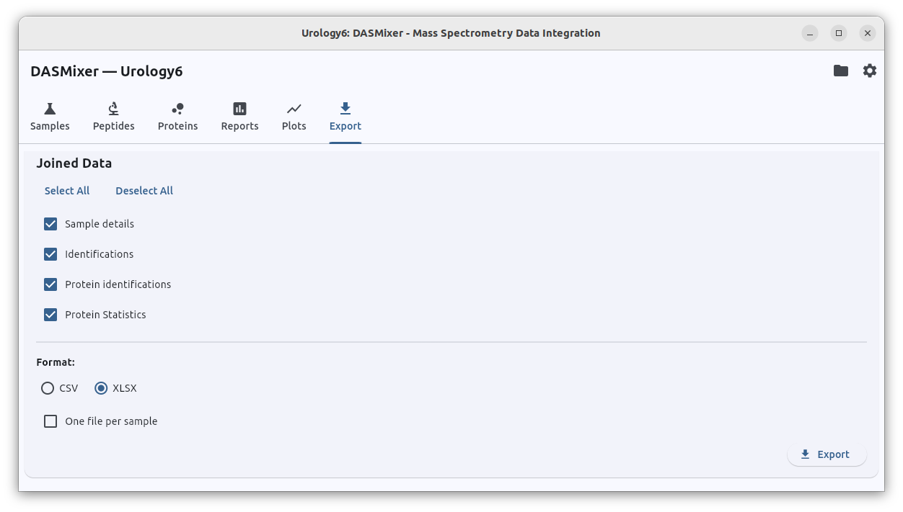
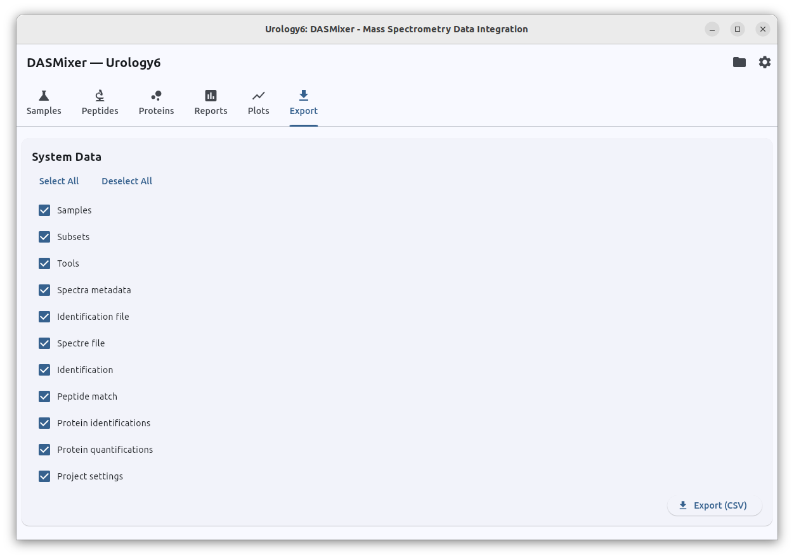
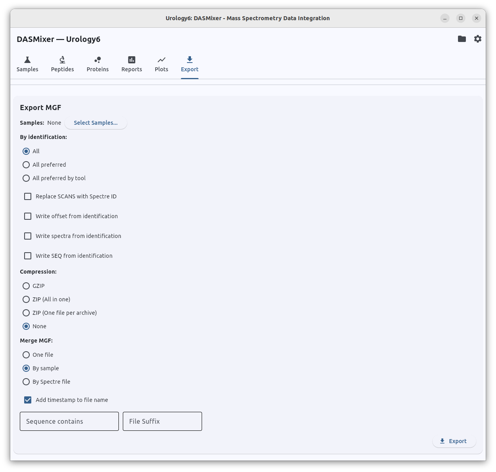
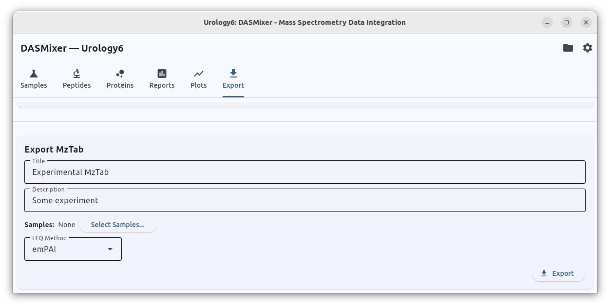

# Data Export (Export Tab)

The **Export** tab provides centralized tools for exporting project data in standard tabular and proteomics formats. Unlike the quick table exports on the Peptides and Proteins tabs (which export only the currently filtered view), the **Export** tab lets you export complete datasets, raw database tables, filtered MGF peak lists, and standardized **mzTab** files.

The tab is organized into four independent sections:

---

## 1. Joined Data Export

Exports high-level, human-friendly analytical views that combine information across multiple database tables: ideal for spreadsheet analysis, custom R/Python scripts, or supplementary publication tables. Format repeats table export in Peptides and Proteins tabs without filtering.

{data-description="Joined Data Export section — select analytical views, choose format, and export."}

### Available Data Sections

You can select any combination of the following four datasets:

- **Sample details** — summary statistics for every sample in the project (comparison group, outlier status, spectra counts, identification counts, preferred counts, and identified protein counts).
- **Identifications** — the complete joined peptide view combining spectrum metadata (`seq_no`, `scans`, `rt`, `pepmass`, `charge`), identification metrics (`tool`, `sequence`, `canonical_sequence`, `ppm`, `score`, `quality`, `lcrr`, `intensity_coverage`, `is_preferred`), and protein match results (`protein_id`, `gene`, `matched_sequence`, `identity`, `unique_evidence`, `substitution`).
- **Protein identifications** — sample-level protein results (`sample`, `subset`, `protein_id`, `gene`, `peptide_count`, `unique_evidence_count`, `coverage_percent`, `intensity_sum`) joined with pivoted LFQ columns (`emPAI`, `iBAQ`, `NSAF`, `Top3`).
- **Protein statistics** — project-wide aggregated statistics per unique protein (total samples and comparison groups in which each protein was detected).

### Options

- **Format:** Choose **XLSX** (Microsoft Excel) or **CSV**.
- **One file per sample:** When checked, the **Identifications** and **Protein identifications** exports are split into separate files per sample rather than written as a single combined table.

Click **Export** and choose an output directory. Files are saved with a timestamp suffix.

---

## 2. System Data Export

Exports raw internal SQLite database tables directly to **CSV** files using asynchronous streaming. This is primarily intended for debugging, archiving raw relational records, or external database ingestion.

{data-description="System Data Export section — export raw SQLite tables to CSV."}

### Available Tables

Use **Select All** / **Deselect All** or toggle individual tables:

- `Samples`, `Subsets`, `Tools`
- `Spectre file`, `Spectra metadata`
- `Identification file`, `Identification`, `Peptide match`
- `Protein identifications`, `Protein quantifications`
- `Project settings`

> **Technical details:** Binary BLOB columns (such as raw $m/z$ and intensity arrays, pickled UniProt records, and serialized report figures) are automatically excluded so the CSV files remain lightweight. JSON columns (such as tool `settings`, sample `additions`, and spectrum `all_params`) are automatically flattened into separate columns prefixed with `{column_name}.{key}`.

Click **Export (CSV)** and select a destination folder. Each selected table is written to `{table}_{timestamp}.csv`.

---

## 3. MGF Export

Reconstructs and exports MS/MS spectra from the project database back into `.mgf` (Mascot Generic Format) files, with rich filtering, header customization, merging, and compression options.

This is especially useful when you want to:

- Export only high-confidence preferred spectra for spectral library building or training dataset
- Export specific spectra, e.g. with specific PTM
- Annotate MGF headers with corrected precursor charges, isotope offsets, or identified `SEQ=` tags

{data-description="MGF Export section — filter spectra by sample and identification, customise headers, and configure output organisation."}

### Filtering and Selection Controls

- **Select Samples…:** Choose which samples to include in the export (should be selected by user).
- **By identification:**
  - **All** — export all spectra in the selected samples.
  - **All preferred** — export only spectra that have a preferred identification.
  - **Preferred by tool** — export only spectra where the preferred identification came from a specific **Tool** (selected from the dropdown).
- **Sequence contains:** Optional substring filter; when filled, only spectra whose identification sequence contains the specified substring are exported.

### Header and Annotation Options

- **Replace SCANS with Spectre ID:** Writes DASMixer's internal `spectre.id` into the MGF `SCANS=` header field.
- **Write offset from identification:** Includes the calculated precursor isotope offset in the spectrum metadata.
- **Write spectra charge from identification:** Uses the SeqFixer-corrected precursor charge (`override_charge`) in the MGF `CHARGE=` field when available.
- **Write SEQ from identification:** Writes the identified peptide sequence into the MGF `SEQ=` header field. When enabled, a dropdown lets you choose between the **Canonical** sequence (unmodified amino acids) or the **Modified** ProForma sequence.

### Output Organization and Compression

- **Merge MGF:**
  - **One file** — combine all exported spectra into a single MGF file.
  - **By sample** (default) — create one MGF file per sample.
  - **By spectre file** — create one MGF file per original imported spectra file.
- **Compression:**
  - **None** — plain `.mgf` text files
  - **Gzip** — compress each MGF file as `.mgf.gz`
  - **Zip all** — package all exported MGF files into a single `.zip` archive
  - **Zip each** — compress each exported MGF file into its own `.zip` archive
- **Add timestamp to file name:** Appends a timestamp to exported filenames to prevent overwriting previous exports.
- **File Suffix:** Optional custom suffix added to the output filenames.

---

## 4. mzTab Export

Exports project results in the standardized HUPO-PSI **mzTab 1.0** format, suitable for repository submissions (such as PRIDE) or downstream tools that consume mzTab files.

{data-description="mzTab Export section — title, description, sample selection, and LFQ method."}

### Controls

- **Title:** Descriptive title for the mzTab metadata header (saved in project settings).
- **Description:** Experiment description for the mzTab metadata header (saved in project settings).
- **Select Samples…:** Choose which samples to include in the mzTab file.
- **LFQ Method:** Select which quantification algorithm (`emPAI`, `iBAQ`, `NSAF`, or `Top3`) to report in the mzTab protein abundance columns.

Click **Export** and choose the target `.mzTab` filename in the Save File dialog.

---

## Importing / Merging Another DASMixer Project

In addition to exporting data, you can merge all data from another `.dasmix` project into your currently open project (for example, when combining batches processed on different workstations).

> **Note:** Both projects must have the same internal `PROJECT_VERSION` schema. If one project was created with an older version of DASMixer, simply open and save it in the current version first to upgrade its schema automatically.

You can merge projects directly from the GUI via **File → Merge Project…** (see [System Menus — Merge Project](system_menus.md#6-merge-project)), via the [Command-Line Interface](advanced/cli.md#6-merging-projects-import-project) (`dasmixer-cli import-project`), or programmatically via the Python API, with full control over how duplicate comparison groups, tools, and samples are matched or renamed.
