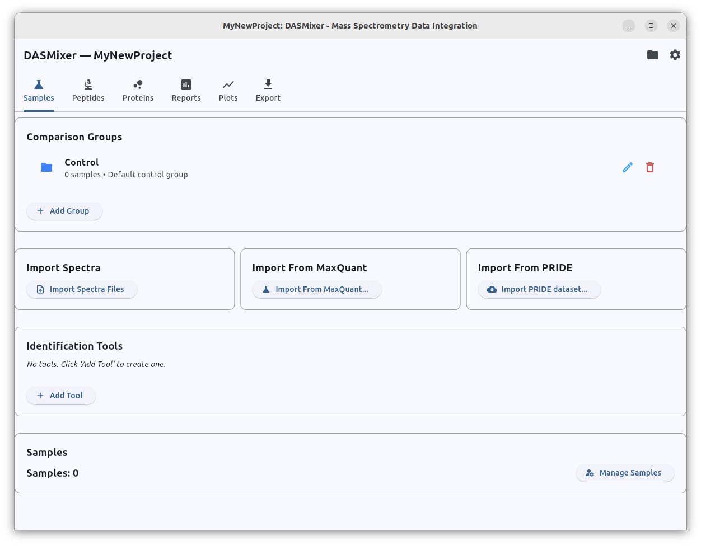

# Getting started

When you run DASMixer, first you will see the main view with options to^
- Create new project
- Open one of the recent projects opened in DASmixer (if there was any)

This screen also shows you the current version of DASMixer below the logo

## Project creation

Create project with "Create New Project" button. First, DASMixer will offer you to choose a location in your file system 
where your porjset file should be placed using standard filepicker.

Keep in mind: DASMixer project file contains copy of all the spectre data you are working with in zipped format, deflated to about 75%. The main consideration here: if you plan to work with, for example, 10GBs of MGF files, jou will need about 7.5GB free disk space for DASMixer project

<!-- TODO: ссылка на описание файла проекта -->

When project is created, you can see the Project view:

For now, project does not cantain any data except for default comparison group called "Control". It can be easily renamed and more groups can be added to this project Using "Add Group" button

## Adding a group

