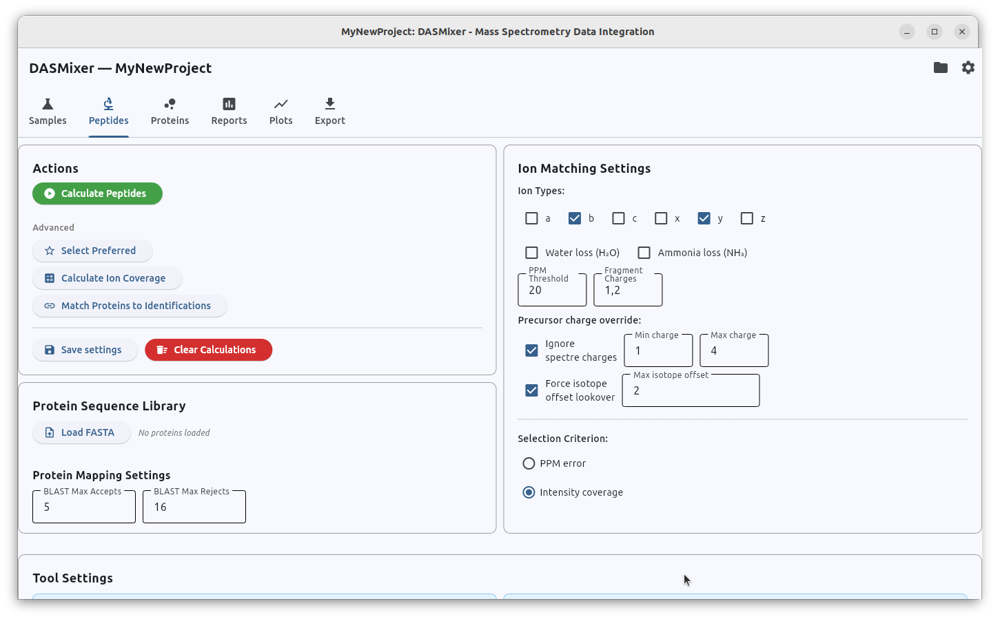
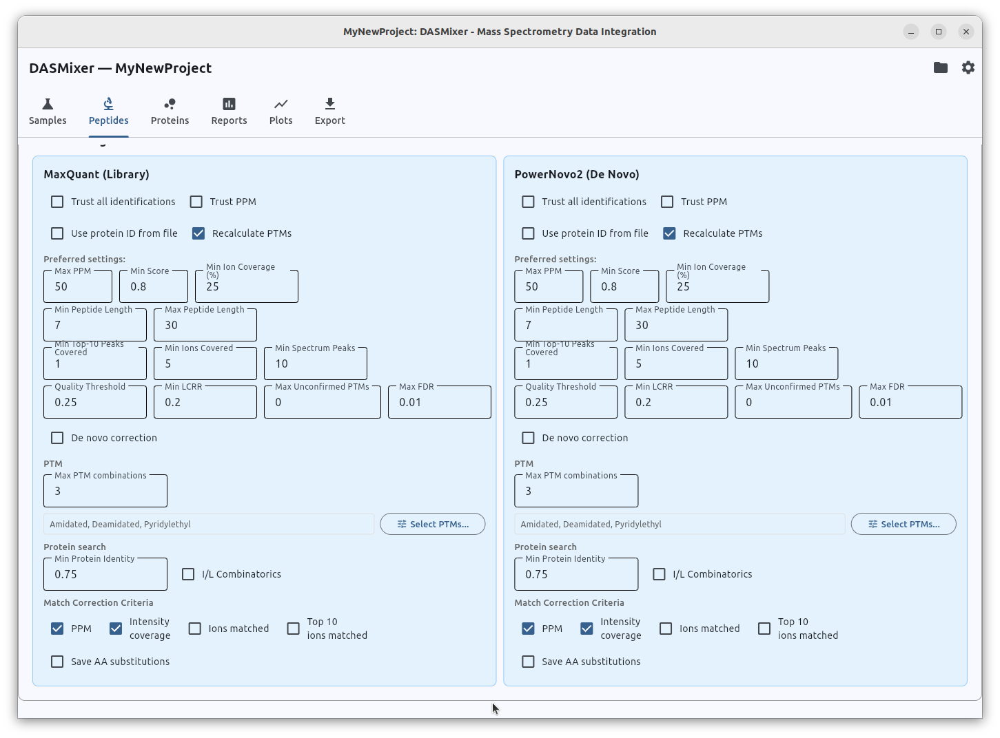
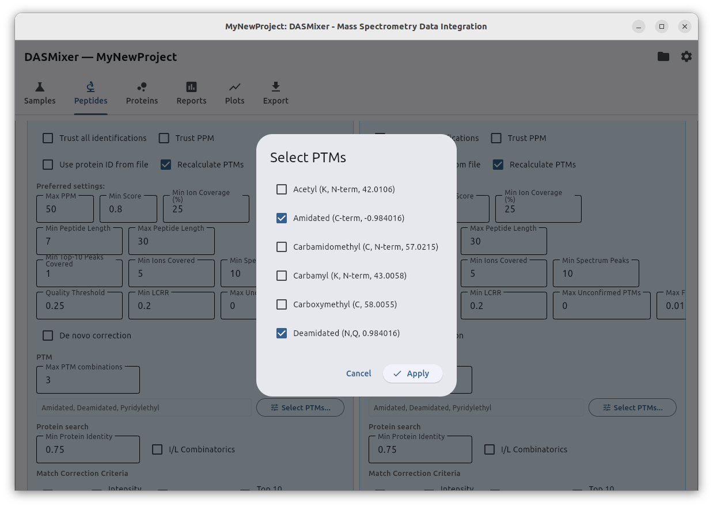
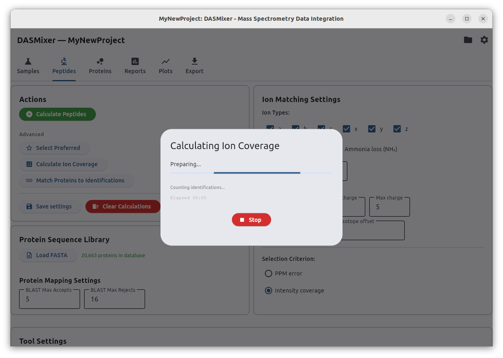

# Processing Identifications (Peptides Tab)

> **Note:** Before reading this section, we strongly recommend reviewing the [Core Concepts and Formulas](../concepts.md) page to familiarize yourself with the metrics and algorithms discussed below.

The **Peptides** tab is divided into five functional sections:

- **Actions** — buttons to execute the full peptide pipeline or individual calculation steps
- **Protein sequence library** — FASTA database import and BLAST search limits
- **Ion match settings** — global fragmentation and precursor refinement parameters
- **Tool settings** — per-tool quality thresholds, PTM rules, and protein mapping options
- **Search and view identifications** — interactive table and MS/MS spectrum viewer (covered in the [next chapter](peptides_table.md))

## Common Settings and Actions

{data-description="Actions, Protein Sequence Library, and Ion Match Settings sections in the Peptides tab header."}

### Actions

The **Actions** panel provides controls for running peptide-level computations:

- **Calculate peptides** (green button) — runs the complete three-stage peptide pipeline sequentially: *Calculate ion coverage* → *Match proteins to identifications* → *Select preferred*.
- **Separate step buttons:**
  - **Calculate ion coverage** — computes precursor PPM, SeqFixer charge/isotope/PTM refinements, fragment ion matches, intensity coverage, Quality, and LCRR.
  - **Match proteins to identifications** — maps peptide sequences against the imported FASTA protein database (including optional *de novo* correction and AA substitution detection).
  - **Select preferred** — filters identifications by tool thresholds and selects the single best identification per spectrum.
- **Save settings** — saves all current ion matching and tool parameters to the project file.
- **Clear Calculations** — resets calculated metrics and protein matches so you can run a clean recalculation.

### Protein Sequence Library

The **Protein sequence library** panel lets you import a reference proteome (`.fasta` file) into the project. You can indicate whether the FASTA headers follow the standard **UniProt** format (`>sp|Accession|EntryName ... GN=GeneName`) so DASMixer can automatically extract accessions and gene symbols.

It also exposes **Max accepts** and **Max rejects** parameters that control the sensitivity and termination criteria of the underlying `npysearch` BLAST-like alignment algorithm during protein mapping.

### Ion Match Settings

The **Ion match settings** panel configures global fragmentation and spectrum-refinement rules shared across all tools:

- **Ion types:** Select which backbone fragment ion series (*a, b, c, x, y, z*) to match against experimental peaks (*b* and *y* are enabled by default).
- **Fragment PPM threshold:** Mass tolerance (in ppm) for matching theoretical fragment ions to experimental MS/MS peaks (default: `20` ppm).
- **Water loss / NH3 loss:** Include neutral loss fragments ($-\text{H}_2\text{O}$ and $-\text{NH}_3$).
- **Fragment charges:** Allowed charge states for fragment ions (e.g., `1+`, `2+`, `3+`).
- **Precursor refinement settings:**
  - **Ignore spectrum charge / Min & Max precursor charge:** Allow DASMixer to test alternative precursor charge states (e.g., `1+` to `4+`) if the MGF charge is missing or inaccurate.
  - **Force isotope offset / Max isotope offset:** Test precursor mass shifts of $\pm n$ neutrons to correct for C13 isotope peak picking errors.
- **Selection criterion:** When multiple tools produce valid identifications for the same spectrum, this radio group determines how the winner is chosen during Preferred Selection (e.g., highest **Intensity coverage** or lowest absolute **PPM** error).

## Tool Settings Section

{data-description="Per-tool configuration card — Main, Preferred, PTM, and Protein search settings."}

Below the global settings, DASMixer displays an expandable configuration card for every tool registered in the project.

> **Tip:** If you just added a new tool on the Samples tab and its card does not immediately appear here, close and reopen the project to refresh the tool panels.

Each tool card contains four parameter groups:

1. **Main checkboxes**
2. **Preferred settings** (quality thresholds)
3. **PTM settings**
4. **Protein search settings**

### Main Tool Checkboxes

- **Trust all identifications:** If checked, every identification from this tool bypasses all quality thresholds and is automatically eligible to be selected as preferred (taking priority over tools without this flag). Useful when importing pre-filtered, high-confidence library search results.
- **Trust PPM:** If checked, DASMixer preserves the original precursor PPM values reported by the search engine instead of recalculating them.
- **Use protein ID from file:** Instead of searching peptides against the FASTA database with `npysearch`, DASMixer uses the protein accessions imported directly from the tool's identification file. (Requires that **Import protein IDs** was enabled when importing the identification files).
- **Recalculate PTMs:** Enabled by default. When checked, DASMixer's SeqFixer will test combinations of enabled PTMs on sequences that fail the precursor PPM threshold in order to find a modification state that matches the precursor mass and improves fragment coverage.

### Preferred Settings (Quality Thresholds)

The **Preferred settings** block defines the criteria an identification from this tool must satisfy to be considered reliable. Reasonable defaults are provided out of the box, and recommended ranges for *de novo* versus database search tools are summarized below:

| Parameter | Description | Recommended for *De Novo* | Recommended for DB Search |
|---|---|:---:|:---:|
| **Max PPM** | Maximum allowed absolute precursor mass error (ppm) | `50` | `10` |
| **Min score** | Minimum search engine confidence score¹ | `0.7` | `0.0` |
| **Min ion coverage (%)** | Minimum spectrum intensity explained by matched fragments | `15–25` | `15–25` |
| **Min peptide length** | Minimum length of the canonical amino acid sequence | `5–7` | `7` |
| **Max peptide length** | Maximum length of the canonical amino acid sequence | `30` | `30–45`² |
| **Min top-10 peaks covered** | Minimum number of the 10 most intense peaks matched | `1` | `1` |
| **Min ions covered** | Minimum total number of matched fragment peaks | `5–7` | `7` |
| **Min spectrum peaks** | Minimum total number of peaks required in the MS/MS spectrum | `10` | `7–10`³ |
| **Quality threshold** | Minimum Bern et al. backbone cleavage [Quality](../concepts.md#quality) index | `0.15–0.25` | `0.15–0.25` |
| **Min LCRR** | Minimum [Longest Consecutive Run Ratio](../concepts.md#longest-consecutive-run-ratio-lcrr) | `0.15–0.25` | `0.15–0.25` |
| **Max unconfirmed PTMs** | Maximum number of PTMs not supported by fragment ions⁴ | `1–2` | `1` |
| **Max FDR** | Maximum per-PSM FDR (if reported by the search engine) | `0.0` (ignored) | `0.01` |
| **De novo correction** | Allow [De novo correction](../concepts.md#de-novo-correction) using FASTA alignments | `Yes` | `No` |

**Notes:**

1. DASMixer does not normalize vendor-specific scores. Most modern *de novo* engines report probabilities between `0.0` and `1.0`. For database search engines whose exports are already filtered by FDR, we recommend setting **Min score** to `0.0`.
2. Higher maximum peptide lengths can be used for non-autoregressive *de novo* models (such as PowerNovo2 or Pi-PrimeNovo) that maintain accuracy on longer peptides.
3. Lower minimum spectrum peak counts may be appropriate for heavily filtered or pseudo-DIA spectra.
4. Allowing `1` unconfirmed PTM is a practical default; tighten this to `0` if precise PTM localization is the primary focus of your study.

### PTM Settings

When **Recalculate PTMs** is enabled, this section controls how DASMixer searches for modifications:

- **Max PTM combinations:** The maximum number of simultaneous modifications SeqFixer can place on a single peptide sequence. Increasing this value allows more complex modification states to be resolved, at the cost of longer computation time.
- **Select PTMs:** Opens a dialog to choose which modifications DASMixer should test during sequence refinement. By default, **Amidated**, **Deamidated**, and **Pyridylethyl** are enabled. Selecting many variable PTMs will combinatorially increase processing time. Custom modifications can also be added — see [PTM Configuration](advanced/ptm_configuration.md).

{data-description="PTM selection dialog — choose which modifications to search during sequence refinement."}

### Protein Search Settings

These parameters control how identifications from the tool are aligned to the FASTA database during the **Match proteins** step:

| Parameter | Description | Recommended for *De Novo* | Recommended for DB Search |
|---|---|:---:|:---:|
| **Min protein identity** | Minimum sequence identity ($0.0\text{–}1.0$) required between the peptide and the protein database | `0.7–0.8` | `1.0` |
| **I/L combinatorics** | Treat isoleucine (`I`) and leucine (`L`) as equivalent during protein matching | `Yes` | `No` |
| **Match correction criteria** | Metrics used to verify whether a database `matched_sequence` explains the spectrum at least as well as the original sequence | `PPM`, `Intensity coverage` | N/A |
| **Save AA substitutions** | Flag high-quality *de novo* sequences that explain the spectrum better than an inexact database match as candidate [AA substitutions](../concepts.md#amino-acid-substitutions) | `Yes` | `No` |

## Calculation Performance and Timing

Different steps in the peptide pipeline have very different computational costs, and total runtime scales with the number of imported identifications:

- **Database search engines** typically report identifications for ~15–25% of MS/MS spectra.
- **De novo sequencing tools** typically report a candidate sequence for nearly 100% of MS/MS spectra (even though only ~20–30% may pass quality thresholds).

Storing your `.dasmix` project on a fast local NVMe/SSD drive (rather than a mechanical HDD or network share) significantly improves database read/write throughput. If your system has plenty of RAM, you can also increase batch sizes in [Settings](configuration.md) to speed up processing.

Typical benchmark timings on an 8-core desktop CPU with an M.2 NVMe SSD per **20,000 identifications**:

- **Calculate ion coverage:** ~3–5 minutes
- **Match proteins (exact match, no *de novo* correction):** ~0.5–1 minute
- **Match proteins (with *de novo* correction / AA substitutions):** ~2–4 minutes
- **Select preferred identifications:** ~1–10 seconds per sample

> **Best Practice:** For large datasets, carefully configure your **Ion match settings**, **PTM settings**, and **Protein search settings** before starting calculations, as full recalculation of ion coverage and BLAST matching across hundreds of thousands of spectra can take hours. By contrast, **Preferred settings** thresholds only affect the lightweight **Select preferred** step — so you can tweak quality thresholds and re-run **Select preferred** in seconds!

## Standard Workflow on the Peptides Tab

1. Open the **Peptides** tab.
2. Import your `.fasta` protein sequence database.
3. Review and adjust global **Ion match settings**.
4. Configure **Tool settings** for each registered tool.
5. Click the green **Calculate peptides** button.
6. Wait for the progress dialog to complete:

{data-description="Progress dialog during peptide pipeline calculation steps."}

Once the calculations finish, scroll down to preview the results in the interactive peptide table and inspect annotated fragment spectra, as described in [Viewing Identification Data](peptides_table.md).
