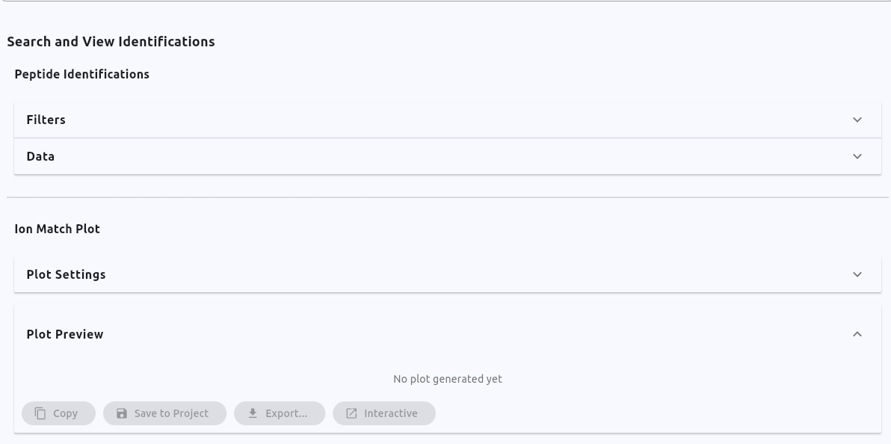
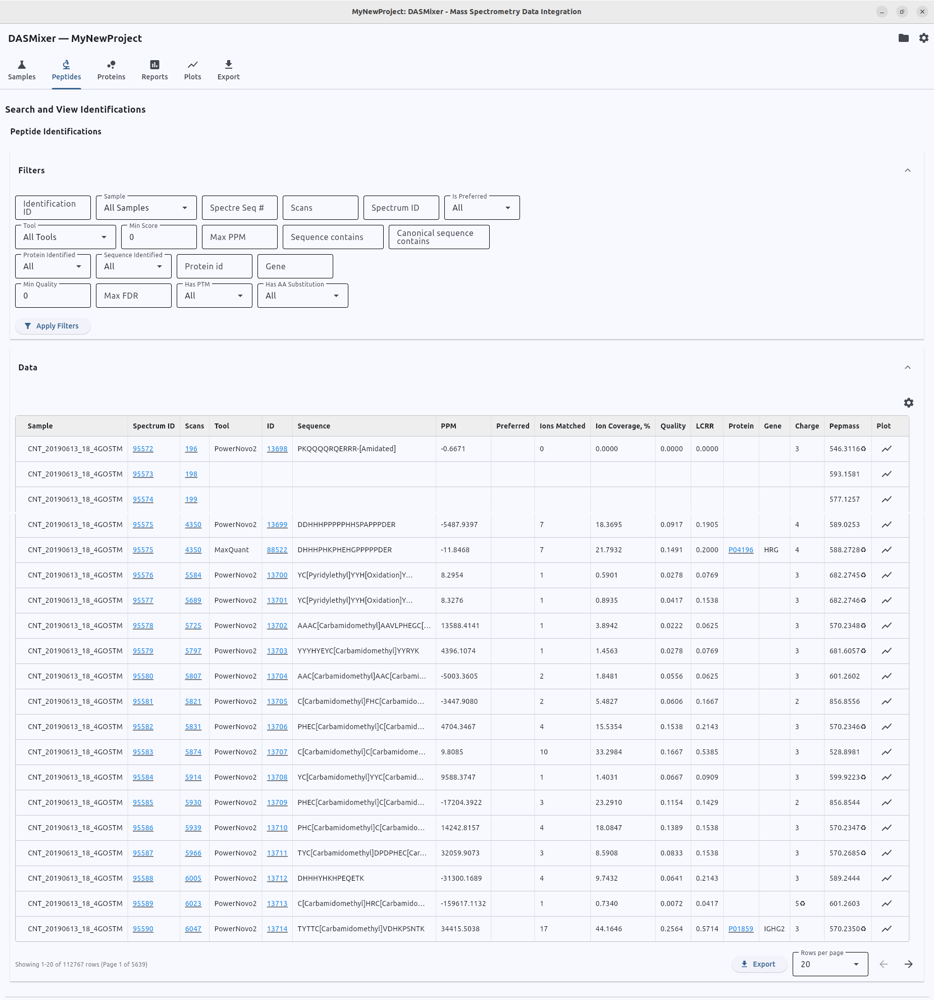
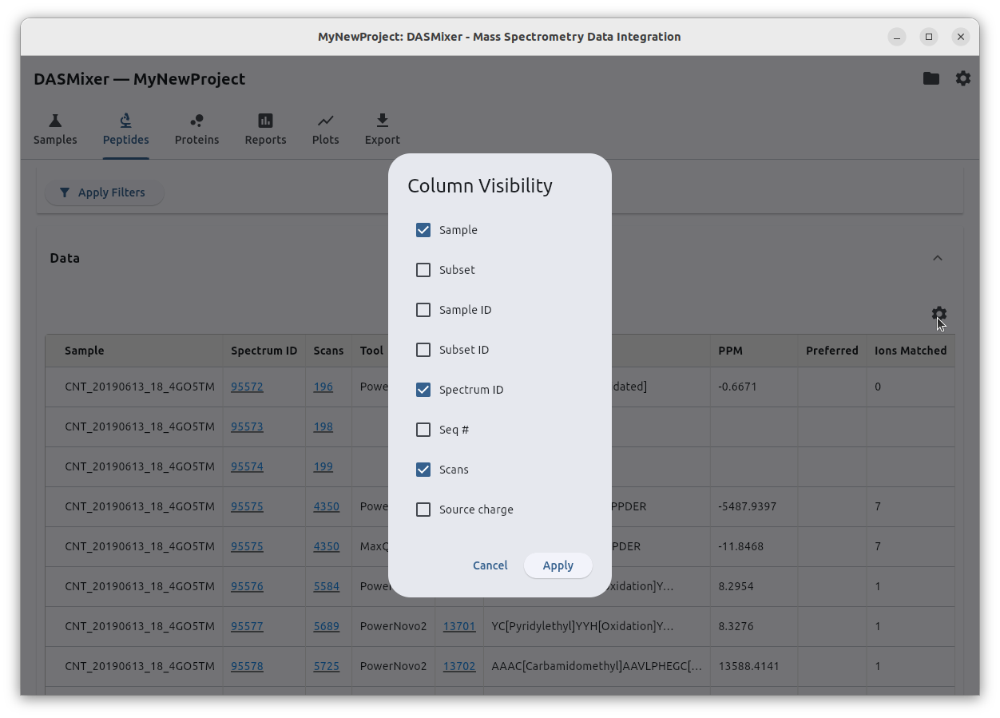
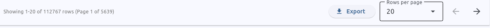
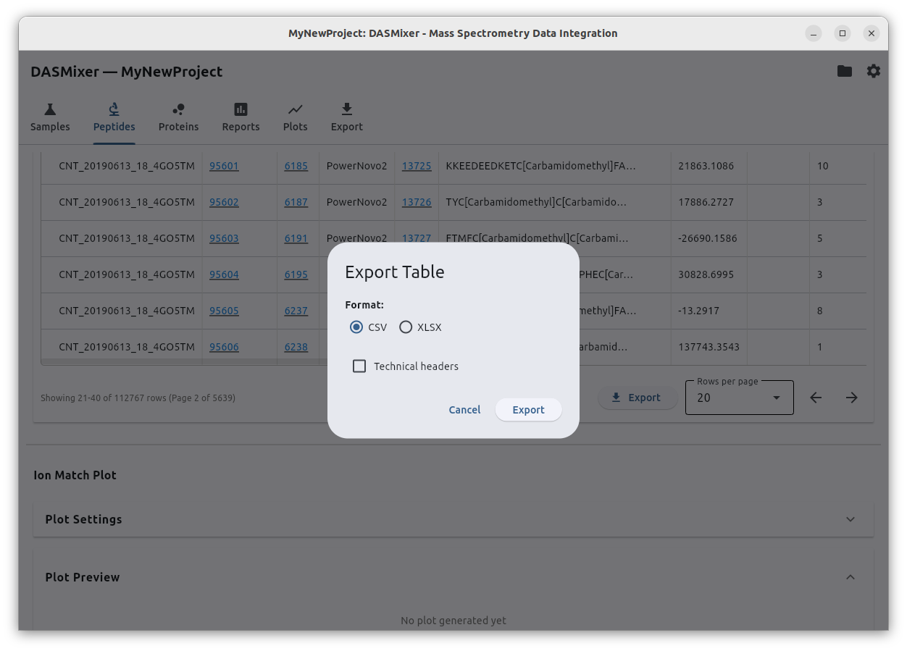
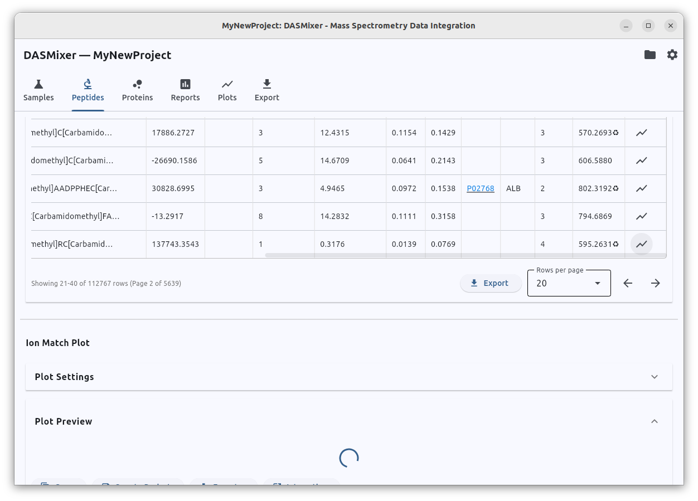
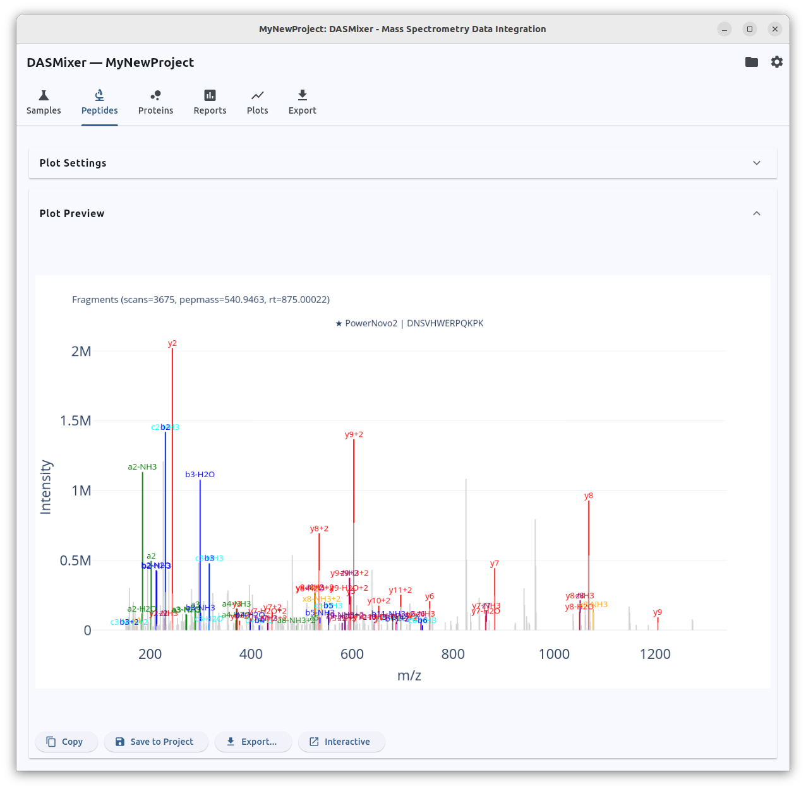
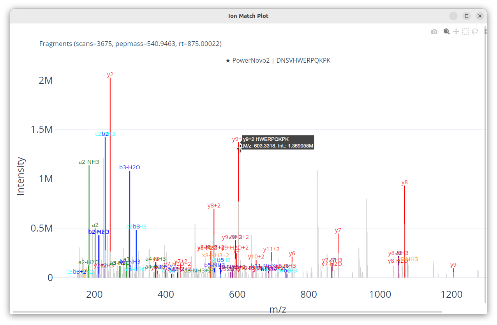
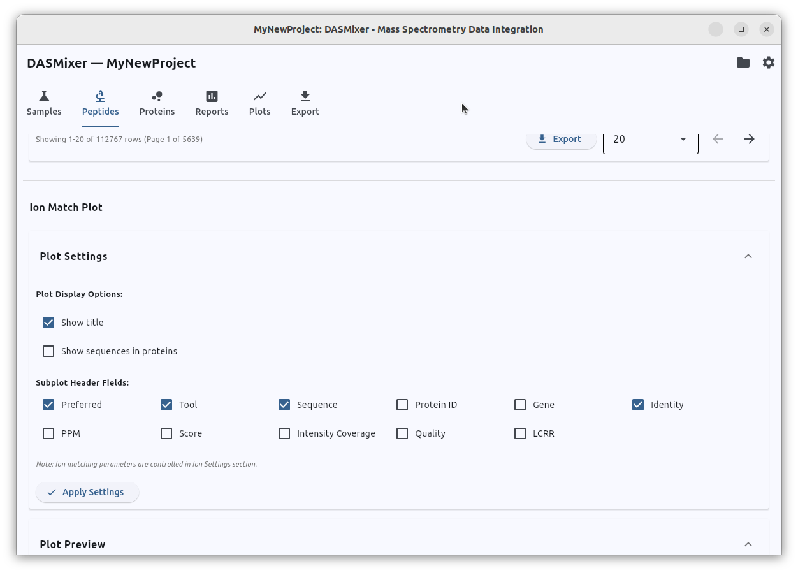

# Viewing Identification Data

Detailed information about every spectrum, peptide identification, and protein match is available in the **Search and view identifications** section at the bottom of the **Peptides** tab:

{data-description="The Search and view identifications section with all four panels collapsed."}

This area is organized into four collapsible panels:

- **Peptide identifications:**
  - **Filters** — query criteria to narrow down rows
  - **Data** — paginated table of spectra, PSMs, and protein matches
- **Ion match plot:**
  - **Plot settings** — display options for the MS/MS spectrum viewer
  - **Plot preview** — annotated fragmentation spectrum plot

Click any panel header to expand or collapse it. The expanded **Filters** and **Data** panels are shown below:

{data-description="The Filters and Data panels expanded, showing the peptide identification table with pagination controls."}

## Filtering Data

You can filter the identifications table using any combination of the following fields:

- **Identification ID** — internal identification primary key in the DASMixer project
- **Sample** — filter by a specific sample
- **Spectre Seq #** — sequential spectrum index (`seq_no`) within the MGF file
- **Spectre Scans** — scan number (`scans`) reported in the MGF file
- **Spectrum ID** — internal spectrum primary key (`spectre_id`) in the project database
- **Preferred** — `All` (show all rows), `Yes` (only preferred identifications), or `No` (only non-preferred identifications)
- **Tool** — filter by identification tool
- **Max PPM** — maximum absolute precursor PPM error
- **Sequence contains / Canonical sequence contains** — substring search within the ProForma sequence (including PTMs) or unmodified canonical sequence
- **Min Quality** — minimum backbone cleavage [Quality](../concepts.md#quality) score
- **Max FDR** — maximum per-PSM False Discovery Rate
- **Protein ID** — exact or partial protein accession (e.g., `P02768`)
- **Gene** — gene symbol (e.g., `ALB`)
- **Protein identified** — `Yes` (mapped to a protein) or `No` (unmapped)
- **Sequence identified** — whether the spectrum has any identification assigned
- **Has PTM** — whether the peptide sequence carries post-translational modifications
- **Has AA substitution** — whether the match is flagged as a candidate amino acid substitution

After entering your filter criteria, click **Apply filters** to refresh the table. You should also click **Apply filters** after running calculations on the Peptides tab to load the newly computed results into the table.

### Quick Drill-Down Links

Several columns in the table — **Spectrum ID**, **Scans**, **ID**, and **Protein** — are rendered as blue underlined hyperlinks. Clicking any value in these columns automatically populates the corresponding filter field and refreshes the table, making it easy to inspect all identifications competing for a single spectrum or all peptides mapped to a specific protein.

## Customizing Visible Columns

To keep the table readable, some columns are hidden by default. Click the gear icon (**⚙️**) in the top-right corner of the table header to open the column selector dialog, where you can check or uncheck individual fields:

{data-description="Column selector dialog — toggle visibility of individual table columns."}

## Pagination and Table Export

Beneath the data table, a control bar provides pagination and export tools:

{data-description="Pagination bar and export controls: row counter, Export button, rows-per-page selector, and page navigation arrows."}

- **Row counter:** Displays `Showing 1–20 of XXXXX rows...`, indicating the total number of records matching the active filters.
- **Export:** Exports **all** rows matching the current filters (not just the visible page) to a file.
- **Rows per page:** Adjusts how many rows are displayed per page.
- **Page navigation arrows:** Step forward or backward through the filtered dataset.

### Exporting Filtered Table Data

Clicking **Export** opens the table export dialog:

{data-description="Table export dialog — choose CSV or XLSX format and toggle technical database column headers."}

- **Format:** Choose between **CSV** (comma-separated values) and **XLSX** (Microsoft Excel workbook).
- **Technical headers:** When checked, exported columns use internal database field names (e.g., `protein_id`, `intensity_coverage`) instead of human-readable display labels (`Protein ID`, `Intensity Coverage, %`).

> **Tip:**
> When exporting data for manuscript supplementary tables or manual inspection in Excel, select **XLSX** and leave **Technical headers** unchecked.
> 
> When exporting data for downstream scripts (Python, R), select **CSV** and check **Technical headers**.
> 
> Note that exporting hundreds of thousands of rows from a large project may take a moment to query and write to disk.

## Useful Filtering Scenarios

Combining filters allows you to quickly answer common biological and quality-control questions:

### 1. Find high-confidence peptides that do not map to the reference proteome
- Set **Preferred** to `Yes` and **Protein identified** to `No`.
- These records may represent unannotated proteoforms, contaminants, or endogenous peptides absent from your FASTA file.

### 2. Find all phosphorylated peptides
- Type `Phospho` into the **Sequence contains** field and click **Apply filters**.

### 3. Inspect candidate amino acid substitutions for a specific protein
- Enter the target accession or symbol in **Protein ID** or **Gene**, and set **Has AA substitution** to `Yes`.

## Viewing Fragmentation Spectra

In the rightmost column of every table row, click the plot icon (**📈**) to generate an annotated MS/MS fragmentation plot for that spectrum.

While the figure is being rendered, a loading indicator appears in the **Plot preview** panel:

{data-description="Plot preview panel showing a loading indicator while the spectrum figure is being rendered."}

Once ready, the annotated spectrum is displayed directly below the table:

{data-description="Annotated MS/MS fragmentation plot with b- and y-ion series highlighted in colour and peak labels."}

Matched fragment ion series (*b*, *y*, etc.) are highlighted in distinct colors with peak labels (`b3`, `y7-H2O`, etc.), while unmatched experimental peaks are drawn in gray. If multiple identifications exist for the selected spectrum, DASMixer stacks subplots vertically — one panel per identification — so you can visually compare how competing sequences explain the same spectrum. Preferred identifications are marked with a star (`★`).

> **Plot sizing tip:** The inline preview image is scaled to fit your current DASMixer window width. To generate a wider image, maximize the application window and click the plot icon (or **Apply settings**) again. You can also change the global **Plot aspect ratio** in [Settings](configuration.md).

Above the rendered figure, four action buttons let you work with the plot:

- **Copy** — copies the high-resolution PNG image directly to your system clipboard. *(Note: On Linux, clipboard support requires `xclip` or `wl-clipboard` to be installed).*
- **Save to project** — stores the plot inside the `.dasmix` project so you can view or batch-export it later from the [Plots tab](plots_tab.md).
- **Export** — saves the figure to disk as a vector **SVG** or raster **PNG** file.
- **Interactive** — opens the plot in a dedicated interactive window where you can zoom, pan, and hover over individual peaks.

> **Publication tip:** Export figures in **SVG** format when preparing manuscripts. Vector graphics scale to any resolution without pixelation and can be edited directly in Inkscape or Adobe Illustrator, or converted to high-DPI TIFF/PNG files.

### Interactive Plot Viewer

Clicking **Interactive** opens the Plotly figure in a standalone viewer:

{data-description="Interactive Plotly viewer window — zoom, pan, and hover over individual fragment peaks."}

> **Troubleshooting the Interactive Viewer:**
> 
> If the standalone interactive window fails to open on your system, go to **Options → Settings**, change **Plot and report view mode** from `Window (pywebview)` to `Browser (default)`, and restart DASMixer.
> 
> **Linux Snap browser note:** If your default web browser is installed as a Snap package (common on Ubuntu), it cannot read files inside hidden directories such as `~/.cache` (as well as /tmp directory). If the browser shows a *File not found* or *Access denied* error, open **Options → Settings** and change the **Temporary files directory** to a non-hidden path inside your home folder (e.g., `~/dasmixer_tmp`).

## Configuring the Spectrum Plot

Between the data table and the plot preview lies the collapsible **Plot settings** panel:

{data-description="Plot settings panel: toggle title, protein mapping sequences, and subplot header fields."}

Here you can customize:

- **Show title** — toggle the main figure header showing scan number, precursor mass, and retention time.
- **Show protein mapping sequences** — add extra subplot panels for database `matched_sequence` alignments alongside the original identifications (especially informative when inspecting *de novo* corrections or amino acid substitutions).
- **Subplot title fields** — choose which metrics (score, PPM, coverage, quality, etc.) are displayed in each identification's subplot header.

After changing any option, click **Apply settings** to redraw the current plot.

> **Note:** Changing fragment matching parameters in the top **Ion match settings** panel will also immediately affect how peaks are annotated when you redraw a plot, even before you re-run the batch **Calculate ion coverage** action.

## Quality Control Checklist Before Moving On

While it is impractical to manually inspect thousands of MS/MS spectra, reviewing a representative sample of both **preferred** and **non-preferred** identifications is an essential quality-control step:

1. Verify that identifications marked as **Preferred** show convincing backbone ion series and low noise.
2. Check that identifications rejected as **Non-preferred** genuinely lack sufficient fragment support.
3. Confirm that the total number of preferred identifications across your samples and tools is sufficient for downstream protein inference.

If the filtering appears too strict or too permissive, adjust the **Preferred settings** on the tool cards and click **Select preferred** — this takes only a few seconds. Once you are satisfied with the peptide-level results, proceed to the [Proteins tab](proteins_tab.md).
