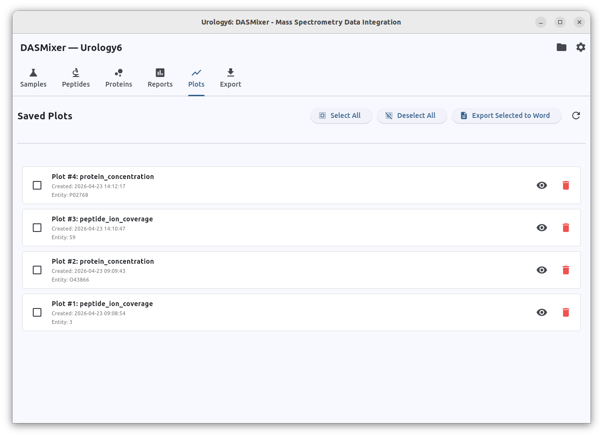

# Saved Plots (Plots Tab)

While working on the [Peptides](peptides_table.md) and [Proteins](proteins_tab.md) tabs, you can click **Save to project** on any MS/MS fragmentation spectrum plot or protein concentration chart. All saved figures are collected in the **Plots** tab, allowing you to review them in one place and batch-export them into a single annotated Microsoft Word (`.docx`) document.

This workflow lets you bookmark interesting spectra (such as candidate amino acid substitutions or PTM-modified peptides) and key protein abundance boxplots during exploratory analysis without interrupting your work to copy-paste individual images.

{data-description="Plots tab showing saved figures as cards with checkboxes for batch Word export."}

## Managing Saved Plots

Each saved figure is displayed as a card showing:

- **Checkbox** — selects the plot for batch Word export
- **Plot ID and Type** — e.g., Spectrum fragmentation plot or Protein concentration plot, along with the associated spectrum/protein identifier
- **Creation timestamp** — when the figure was saved to the project
- **View** — opens the saved plot in the interactive viewer (with automatic PNG fallback) so you can inspect it again
- **Delete** — removes the saved plot from the project database (after confirmation)

At the top of the tab, use **Select All**, **Deselect All**, and **Refresh** to manage the list.

## Batch Exporting to Microsoft Word

To compile your bookmarked figures into a single document:

1. Check the boxes next to the plots you want to include (or click **Select All**).
2. Click **Export Selected to Word**.
3. Choose a destination `.docx` file path in the Save File dialog.

DASMixer renders each selected Plotly figure to a high-resolution PNG image in the background and embeds it into the Word document alongside a structured table of the plot's saved configuration and metadata. You can then copy the images and captions directly into your manuscript or supplementary materials.
