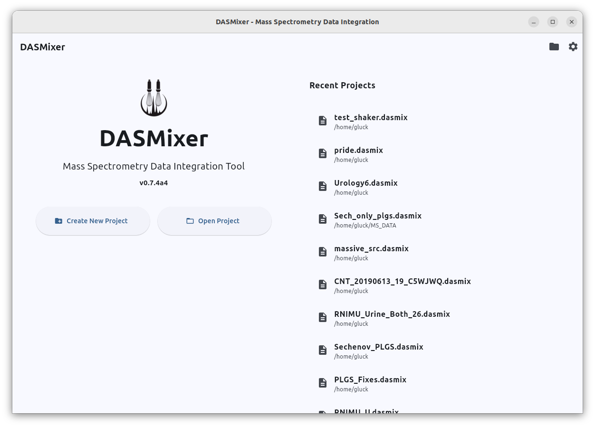
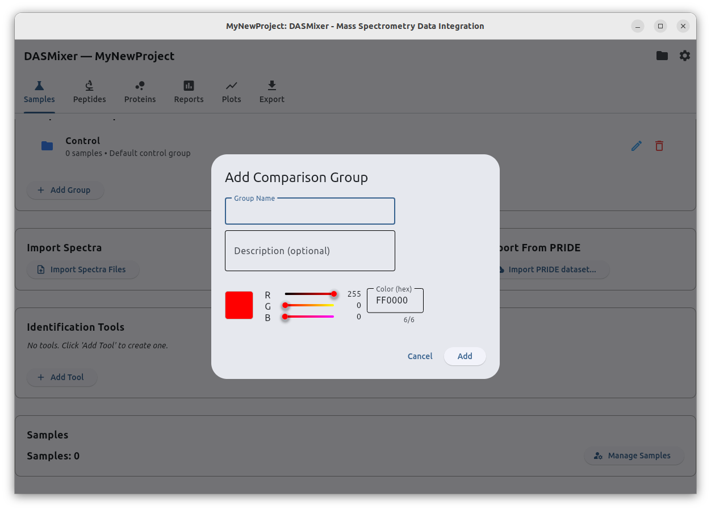
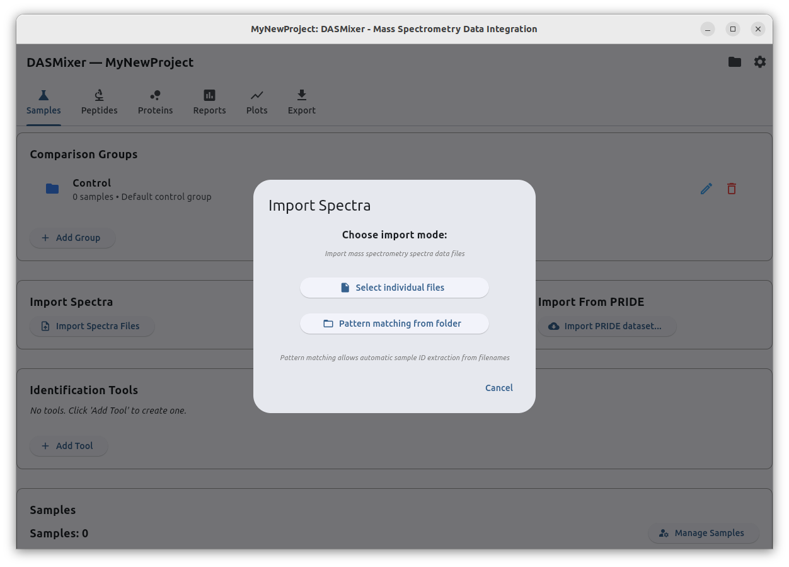
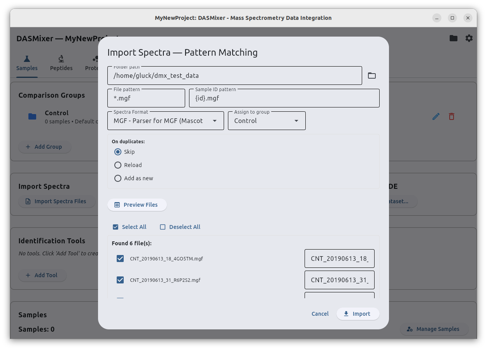
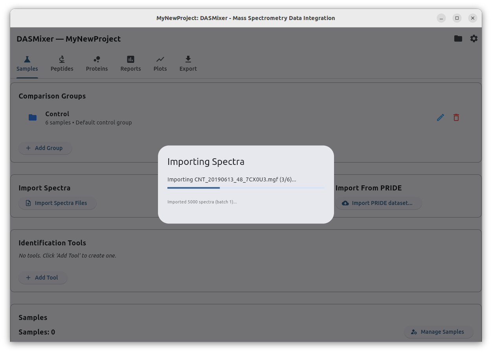
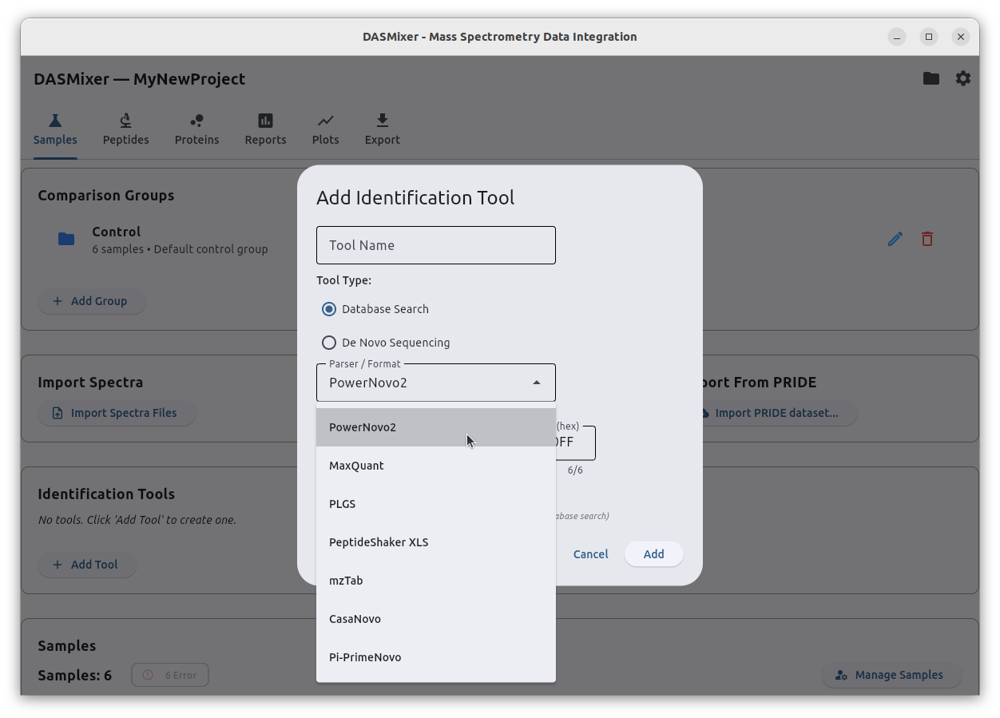
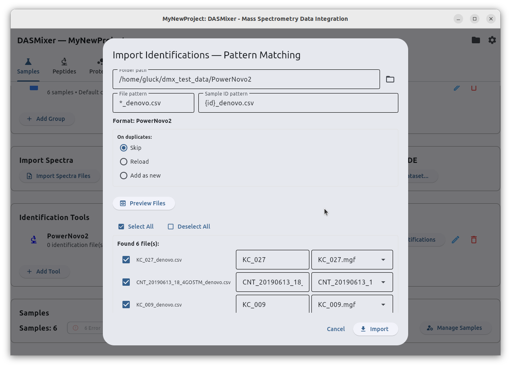

# Getting started

When you run DASMixer, first you will see the main view with options to^
- Create new project
- Open one of the recent projects opened in DASmixer (if there was any)

This screen also shows you the current version of DASMixer below the logo

## Project creation

Create project with "Create New Project" button. First, DASMixer will offer you to choose a location in your file system 
where your porjset file should be placed using standard filepicker.

Keep in mind: DASMixer project file contains copy of all the spectre data you are working with in zipped format, deflated to about 75%. The main consideration here: if you plan to work with, for example, 10GBs of MGF files, jou will need about 7.5GB free disk space for DASMixer project

<!-- TODO: ссылка на описание файла проекта -->

When project is created, you can see the Project view:

Projct data and actions is split into 6 tabs:
- Samples
- Peptides
- Proteins
- Reports
- Plots
- Export

For now, project does not cantain any data except for default comparison group called "Control". It can be easily renamed and more groups can be added to this project Using "Add Group" button

## Working withcomparison groups (subsets)

You can add, edit and delete comparison groups (or "subsets" in DASMixer terms).

> Technical note: "Subset" term has been choosen for technical representation because DASMixer project is SQLite database, and SQL language has reserved word "group". Using subset as table name makes internal queries more readable and writeable.

To add subset, click "Add group" button on the Samples tab. You will enter the "Add Comparison Group" dialog:

Here you can set name and description for the subset. You can also customize subset color: it will be used in plots when your research results will be compared between groups.

To edit created subset you can use the pencil (✏️) button near the group name with the same form.

Groups can be deleted using button with trash bin icon. However, only empty groups can be deleted, so you should first delete or move every sample from this group.

## Import spectral data

Next important step is spectra import.  DASMixer currently supports only .MGF spectra import format.
It is also recommended to import already processed deconvoluted, denoised and deisotoped .MGF files.
Import start by clicking "Import spectra" button

There is two ways to import spectra:
- By one file
- Using pattern matching

One file is simple, you should just select file from file picker and (optionally) edit sample name. Pattern matching is more tricky.

First, you should select (or paste) path to the folder containing your MGF files. Then press "Preview files" button.

This dialog contains two fields for patterns:
- File pattern: format to select files you want to import. in this pattern format, `*` symbol stands for any sequence of symbols. If you want to import every .MGF file in folder, default pattern `*.mgf` is fine. However if you want to get only files with name starts with "CNT_", you can correct this pattern to `CNT*.mgf`
- Sample ID pattern: format to parse sample name from file name. substitute sample name part with `{id}`. Other variable parts can be substituted with `{}` and fixed parts can be added as is to the pattern. For example, if you have files named `20260912_S01_DDA.mgf` and `20260914_S02_DDA.mgf`, you can use pattern `{}_{id}_DDA.mgf` and store them as seamples S01 and S02 respectively.

> Technical note for python enthusiasts: File pattern is passed to pathlib.Path.rglob() method while Sample ID pattern used with parse.parse() function.

After adjusting patterns, you should always check if mapping fits your expectations by clicking "Preview files" and look at the changes in list below. You can manually rename samples and deselect files you don't want to import.

If everything is OK, press the "Import" button and wait for the spectra to be imported:

Modal dialog will disappear when import is done.

# Create tool and import identifications

Next step is to create tool(s) by clicking "Add tool"

Tool is a search engine wich results you want to import. Setings dialog includes:
- Tool name
- Tool type (database/de novo)
- Parser: type of input files you work with. Selected from supported sources
- Color (used in reports)

When tool is created, you can see the list of tools in project and press "Import identifications" button for one of the tools. Import process i commonly the same as for spectre import but pattern adjusting is more important.

Most of the engines provides results as set of files with the same filename extensions but different prefixes, so it should be difined. For instance, PowerNovo2 creates several CSV files with different data details. Identifications can be imported from `*_denovo.csv` files only.
The same is fair to PLGS: you should import *_peptide.csv files.

> **Hint**: If files stored in complex folder tree, like `/your-data-root/comparison_group/denovo_output/sample_01/sample_01_denovo.csv`, you can set only file name pattern and import path to `/your-data-root/`.
> Potential problem: if results are stored in structure like `/experiment/sample01/denovo.tsv` (same filenames in every folder) you will have to rename files before import or import manually file per file

After data is imported, you can add another tool (e.g. MaxQuant), validate imports on "Manage samples" view or proceed to Peptides tab to view data and perform calculations  