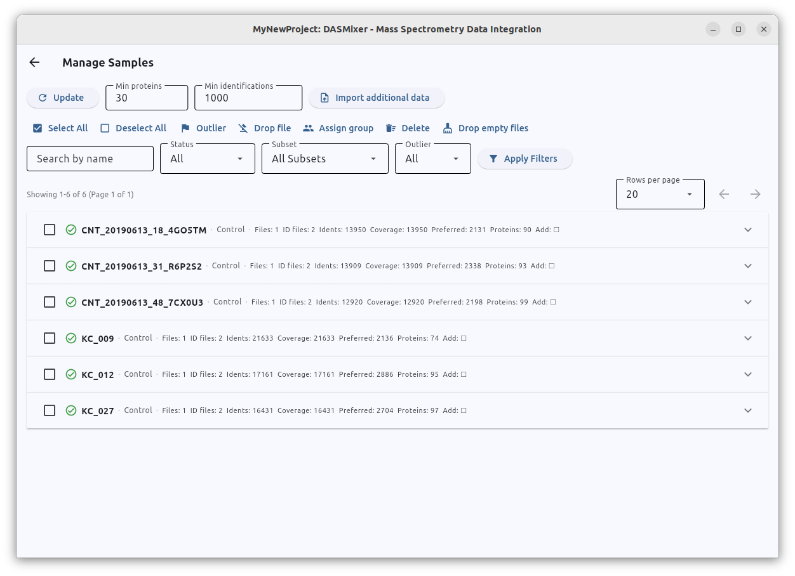

# Getting Started: Projects and Samples

When you launch DASMixer, you are greeted by the Start screen, which provides options to:

- **Create New Project**
- **Open Project** from disk
- Quickly reopen any of your **Recent Projects** (up to 10 recent `.dasmix` files)

The current version of DASMixer is displayed directly beneath the application title. At the top-right corner of the window, the application bar provides the **File** (folder icon) and **Options** (gear icon) menus, which remain accessible from every screen for saving, merging, or closing projects and configuring global preferences — see [System Menus (File & Options)](system_menus.md) for a complete overview.

{data-description="The DASMixer Start screen — create, open, or quickly reopen recent .dasmix projects."}

## Creating a Project

Click **Create New Project** to start. DASMixer will open a file dialog asking you to choose a location and filename for your new `.dasmix` project file.

> **Disk Space Note:** A DASMixer project file is a self-contained SQLite database that stores a compressed copy of all imported spectral peak lists (typically compressed to around 25–30% of the original MGF size, i.e., deflated by ~70–75%). For example, if you plan to import 10 GB of raw MGF files, ensure you have at least 3–8 GB of free disk space available on the target drive. See [Project File Structure](../developer/project_structure.md) for technical details.

Once the project is created, the main **Project View** opens on the **Samples** tab:

{data-description="Freshly created project open on the Samples tab, showing the default Control comparison group."}

Project data and workflows are organized into six tabs across the top of the window:

1. **Samples** — manage comparison groups, tools, spectral files, and sample metadata
2. **Peptides** — configure ion matching, tool thresholds, FASTA mapping, and inspect PSMs
3. **Proteins** — infer protein identifications, enrich from UniProt, and run LFQ
4. **Reports** — generate statistical and comparative reports
5. **Plots** — review and batch-export saved figures
6. **Export** — export raw tables, joined views, filtered MGFs, or mzTab files

A newly created project starts empty except for one default comparison group named **Control**. You can rename this group or add additional groups using the **Add Group** button.

## Working with Comparison Groups (Subsets)

Comparison groups (referred to as **Subsets** in DASMixer's internal data model and some report parameters) divide your samples into biological or experimental conditions (e.g., *Control* vs. *Treatment*).

> **Technical note:** The term *Subset* is used internally because a DASMixer project is a SQLite database, and `GROUP` is a reserved keyword in SQL.

To create a new group, click **Add Group** in the **Comparison Groups** section on the **Samples** tab. This opens the **Add Comparison Group** dialog:

{data-description="Add Comparison Group dialog — name, description, and display colour."}

Here you can specify:

- **Name** — a unique name for the group
- **Details** — an optional description of the experimental condition
- **Display color** — the color used to represent this group in PCA, Volcano, and protein concentration plots

To edit an existing group, click the pencil icon next to its name. To delete a group, click the trash bin icon. Note that **only empty groups can be deleted** — if a group already contains samples, you must first reassign or delete those samples via **Manage Samples**.

## Importing Spectral Data

The next step in a standard workflow is importing MS/MS spectra. DASMixer supports `.mgf` (Mascot Generic Format) files, including both standard MGF and Waters **MGF (PLGS Pseudo-DIA)** formats. For best results, we recommend using peak-picked, deconvoluted, denoised, and deisotoped MGF files.

Click **Import Spectra** to begin:

{data-description="Import Spectra dialog — Single file and Pattern matching import modes."}

DASMixer offers two modes for importing spectra:

- **Single file** — select one `.mgf` file via the file picker, assign it to a comparison group, and optionally customize the sample name.
- **Pattern matching** — batch-import multiple `.mgf` files from a directory and automatically extract sample names from their filenames.

### Batch Import with Pattern Matching

When you choose **Pattern matching**, first select or paste the path to the folder containing your MGF files, then click **Preview files**:

{data-description="Pattern matching spectra import — configure File pattern and Sample ID pattern, then preview extracted sample names."}

This dialog uses two pattern fields to discover files and name samples:

- **File pattern:** A glob pattern used to filter which files in the folder (and its subfolders) to import. The `*` wildcard matches any sequence of characters. To import all MGF files in the directory, leave the default `*.mgf`. To import only files starting with `CNT_`, use `CNT*.mgf`.
- **Sample ID pattern:** A template used to extract the sample name from each filename. Use `{id}` to mark the portion of the filename that should become the sample name, and `{}` to ignore other variable parts. For example, if your files are named `20260912_S01_DDA.mgf` and `20260914_S02_DDA.mgf`, the pattern `{}_{id}_DDA.mgf` will extract sample names `S01` and `S02` respectively.

> **Technical note for Python users:** The *File pattern* is evaluated with `pathlib.Path.rglob()`, while the *Sample ID pattern* is parsed using the [`parse`](https://pypi.org/project/parse/) library's `parse.parse()` function.

After adjusting the patterns, click **Preview files** to verify that the extracted sample names match your expectations. In the preview list, you can manually edit individual sample names or uncheck files you wish to skip.

Once everything looks right, click **Import** and wait for the batch import to complete:

{data-description="Spectra import progress dialog with per-file status."}

The progress dialog will close automatically when all spectra have been imported.

> **One-click workflow imports:** If you are importing a complete **MaxQuant** project (`mqpar.xml`) or downloading a public dataset directly from the **PRIDE Archive** (`PXD...`), you can skip manual MGF and tool creation by using the **Import From MaxQuant…** or **Import From PRIDE…** buttons directly on the Samples tab. See [MaxQuant Import](advanced/MaxQuant.md) and [PRIDE Dataset Import](advanced/pride_import.md) for details.

## Creating Tools and Importing Identifications

Once spectra are loaded into the project, register the search engines or *de novo* tools whose results you want to integrate. Click **Add Tool** in the **Identification Tools** section:

{data-description="Add Tool dialog — name, type (Library / De Novo), parser, and display colour."}

In the **Add Tool** dialog, configure:

- **Tool name** — a unique display name (e.g., `PowerNovo2`, `MaxQuant`, `CasaNovo`)
- **Tool type** — `Library` (database search) or `De Novo`
- **Parser** — the file format importer matching your tool's output (`PowerNovo2`, `MaxQuant`, `PLGS`, `PeptideShaker XLS`, `mzTab`, `CasaNovo`, `Pi-PrimeNovo`, or any installed custom plugin)
- **Color** — the display color used for this tool in comparison charts

After adding the tool, click **Import Identifications** on the tool card. Depending on the selected parser's capabilities, you can import identifications via:

- **Single file** — link one identification file to a specific sample/spectra file
- **Pattern matching** — batch-match identification files to existing samples using `{id}` patterns
- **Stacked file** (e.g., MaxQuant `evidence.txt`) — split a single multi-sample table across samples using the sample column (`Raw file`)
- **Multifile** (e.g., multi-run `mzTab`) — automatically map identifications from a combined file to their respective spectra files

When using **Pattern matching** for identifications, pay close attention to the **File pattern**. Many search engines generate multiple CSV/TSV files in the same output folder with different suffixes:

- For **PowerNovo2**, import only `*_denovo.csv` files (and set the Sample ID pattern to `{id}_denovo.csv`).
- For **Waters PLGS**, import only `*_peptide.csv` files.

> **Tip:** Because pattern matching searches subdirectories recursively, if your results are organized in a nested folder structure such as `/data/group_A/denovo_output/sample_01/sample_01_denovo.csv`, you can simply point the folder picker to `/data/` and use `*_denovo.csv` as the file pattern.
>
> **Watch out:** If your files have identical names inside sample-specific folders (e.g., `/experiment/sample01/denovo.tsv` and `/experiment/sample02/denovo.tsv`), filename-based pattern matching cannot distinguish them — either rename the files to include the sample ID or import them individually.

{data-description="Import identifications configuration — Single file, Pattern matching, Stacked file, or Multifile modes."}

If your identification files contain protein accessions (supported by parsers like `PLGS`, `MaxQuant`, `PeptideShaker XLS`, and `mzTab`), you can also enable **Import protein IDs from file** during import.

## Managing Samples

At the bottom of the **Samples** tab, the **Samples** summary bar displays the total number of samples in the project along with status counters (**OK**, **Warning**, **Error**, **Pending**).

Clicking **Manage Samples** opens a dedicated full-screen view where you can:

- Inspect each sample's imported spectra files and identification files
- Filter samples by name, comparison group, status, or outlier flag
- Mark or unmark samples as **Outliers** (outliers can be excluded from statistical reports and plots)
- Reassign samples between comparison groups in bulk
- Remove empty files or delete unwanted samples
- Import **Additional sample metadata** from a CSV or Excel table (such as total protein concentration or albumin concentration for [Absolute Quantification](advanced/abs_concentrations.md))
- Run pipeline steps (ion coverage, preferred selection, protein mapping, LFQ) for an individual sample

{data-description="Manage Samples view — filter, inspect, reassign, and bulk-edit samples and their associated files."}

Once your spectra and identifications are imported, proceed to the [Peptides tab](peptides_tab.md) to configure parameters and run peptide-level calculations.
