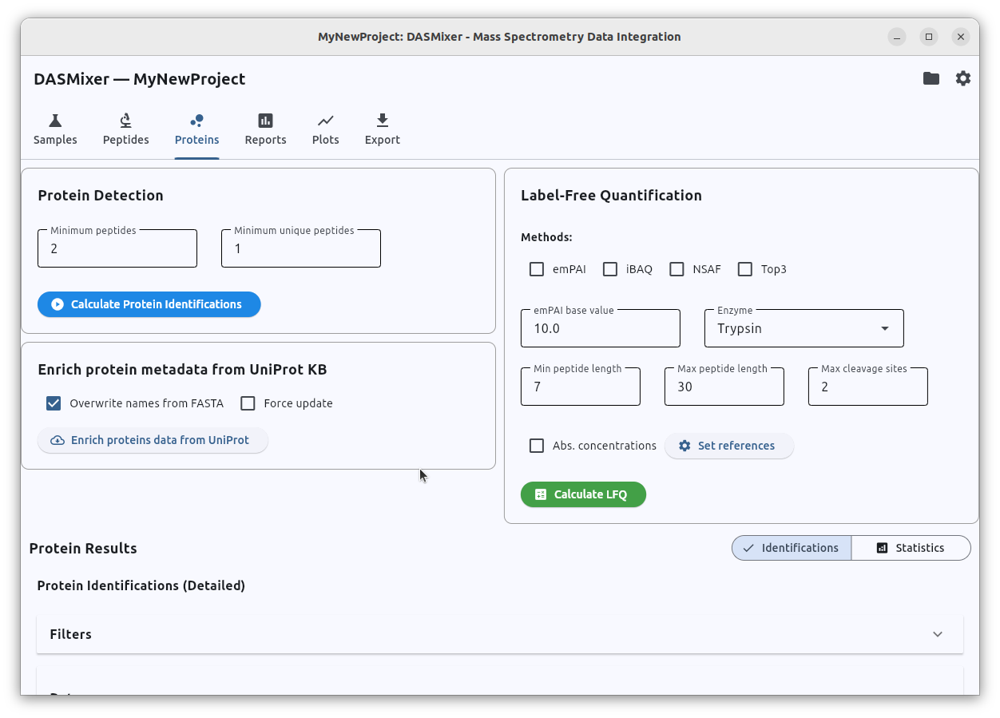
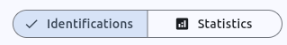
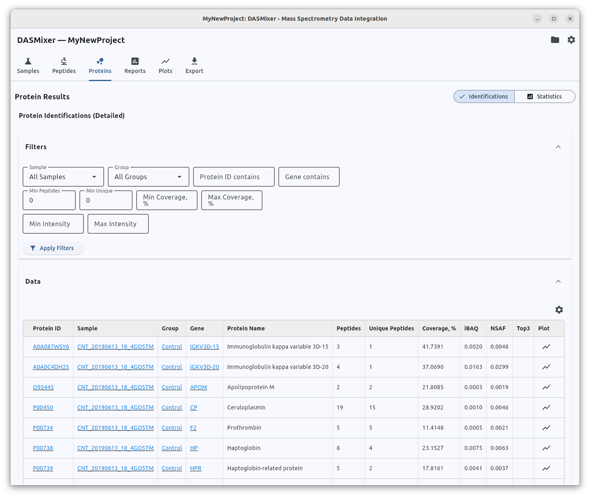
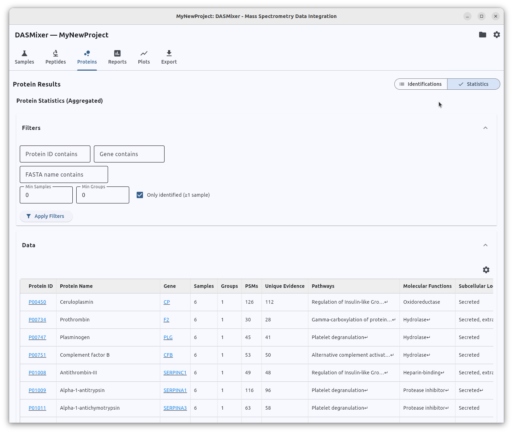
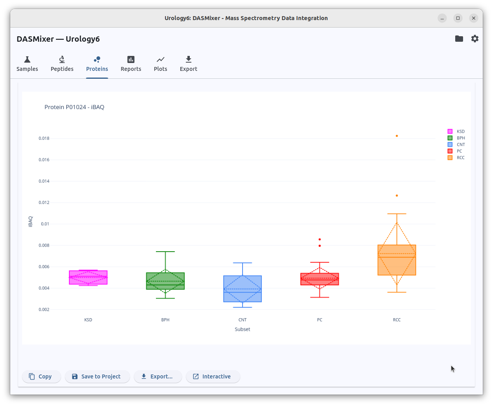
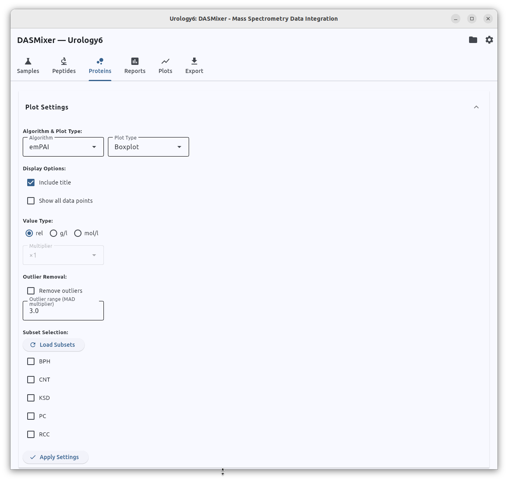

# Working with proteins

Proteins tab contain three settings/processing blocks and table view, very similar to [one on the peptides tab](peptides_table.md)

## Controls

- Protein detection block
  - Minimum peptides: minimum of preferred identifications mapped to a protein in the sample to trust its existence in this sample.
  - Minimum unique peptides: minimum of preferred identifications in the sample that corresponds only to the given protein
  - "Calculate protein identifications" button: starts the protein identification process
- Label-free quantification
  - Methods: select [label-free quantification methods](../lfq.md) to calculate. Currently, DASMixer supports four methods:
    - emPAI
    - iBAQ
    - NSAF
    - Top3
  - emPAI base value: configure base value for emPAI. Most common is 10, but there is researches assuming other values as better.
  - Enzyme, min/max peptide length, max cleavage sites: emPAI and iBAQ relies on "detectable peptides number" as a variable, so to calculate these parameters, DASMixer should perform in silico digestion of the protein sequence in conditions close to experimental
  - Abs concentrations/set references: refer to [Absolute concentrations](advanced/abs_concentrations.md)
  - "Calculate LFQ" button: runs LFQ calculations based on given settings
- Enrich protein metadata from UniprotKB:
  - overwrite names from fasta: overwrite protein names
  - Force update: overwrite protein data with UniProt metadata
  - Enrich protein data from UniProt

## Processing order

It is strictly recommended to follow the next order of calculations:

0. Make sure there are enough preferred identifications
1. Run "Calculate protein identifications"
2. Run "Enrich protein metadata from UniProtKB" (especially if you imported protein identifications from search engine and did not import protein database)
3. Run "Calculate LFQ".

## Important notes

1. Keep in mind that protein identifications are calculated only from preferred identification.
2. Preferred identification are taking without consideration of tool produced it. But there can be only one preferred identification per spectre
3. You always need to "Calculate protein identifications" before calculate LFQ as LFQ calculation requires protein identifications calculated
4. UniProtKB enrichment requires internet connection
5. Only proteins found with given criteria by minimum peptides/minimum unique peptides will be enriched from UniProt, if you make criteria softer, rerun enrichment step
6. UniProtKB Enrichment can be skipped if you imported .fasta file before and do not need additional information like pathways, biological functions, subcellular locations etc.

## Protein data view

**Important**: After calculation, do not forget to open filter block and press "Apply settings" button!

Proteins tab offer two tables that can be switched by the buttons block:

**Identifications table** present protein identifications per sample with LFQ values.

**Statistics table** aggregates identification data to one line per protein displaying amount of samples and groups containing this protein.

## Protein plots

DASMixer can draw boxplots and violin plots to display difference in concentration of the specified protein between comparison groups in the project.
UI is commonly the same as for fragmentation plots in the Peptides tab.

Plot settings expandable block allows you to:
- select LFQ method witch values should be shown on a plot
- select plot type: boxplot or violin plot
- customize plot apperance with title and flag to show all data points
- select value type: relative, absolute in g/l, absolute in mol/l
- if absolute value selected, multiplier option allows to change value from g/l to mg/l, ng/l etc.
- outlier values can also be removed from the plot based on times difference with median
- and also comparison groups (subsets) can be added to/removed from the plot using "Subset Selection" block

## Insights

Protein tab leads to understanding of proteome of the whole experiment, group-specific proteins
and differential expression of the proteins between the comparison groups. It also gives a tool to create plots to compare 
protein concentrations between groups. And after collecting proteins data ot this tab, you may proceed to prepare [reports](reports.md)