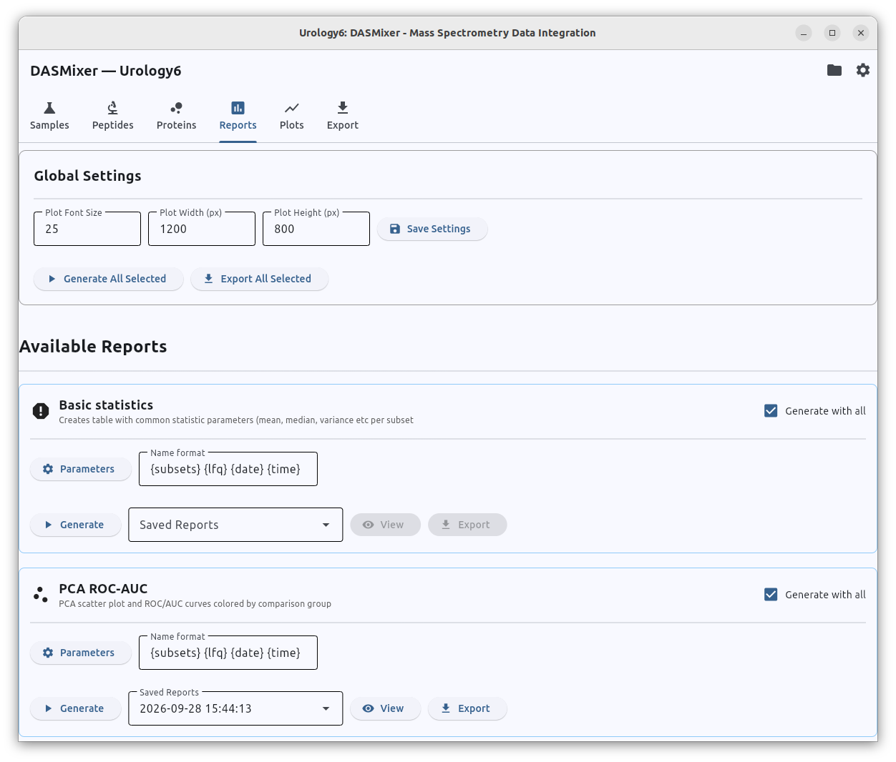
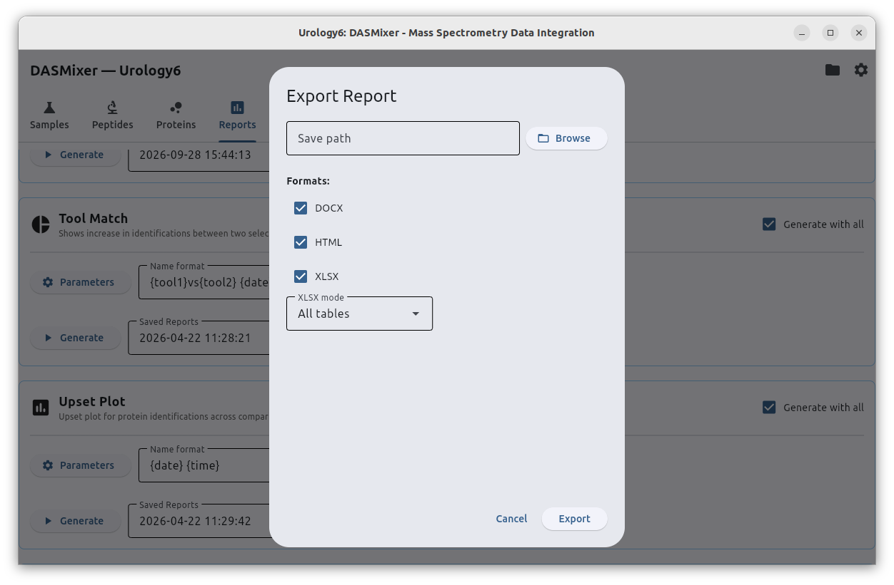

# Reports

Reports is the source of most important information about project at all, including statistical data, tool comparison and insights on difference between subsets.

Reporting is extendable function, so it is possible to create reports as plugins for DASMixer.

Out-of-the-box DASMixer offers the following reports:
- Tool match report: compares identifications of peptides and proteins between two tools, shows the share of preferred identifications for each tool used
- Volcano report: builds volcano plot and calculates fold changes and p-values of given difference for independent subsets
- Basic statistics: calculated common statistic values for protein abundance in subsets: mean, median, std, variance etc.
- PCA AUROC: performs Principal component analysis to differentiate subsets and draws Receiver Operating Characteristic curve with area under the curve calculation
- Upset plot: creates upset plot and lists group-specific proteins

Every report has several common controls form with report-specific settings.

Common controls are:
 
- Parameters button to open report-specific form
- "Generate" button to genereate report
- "Name format" field to configure report name. this field includes substitutions of report parameters
- "Saved reports" dropdown to select previously generated reports
- "View" button to preview report in interactive mode
- "Export" button to export report data.

## Report export

Export is configurable as shown below:

Report consists of:

- report parameters
- project and tools parameters saved at the report generation moment
- interactive plots
- small tables inc