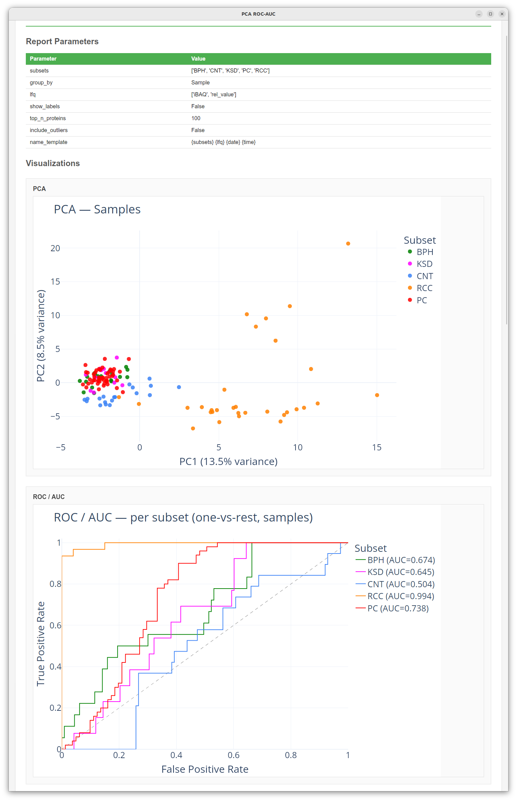
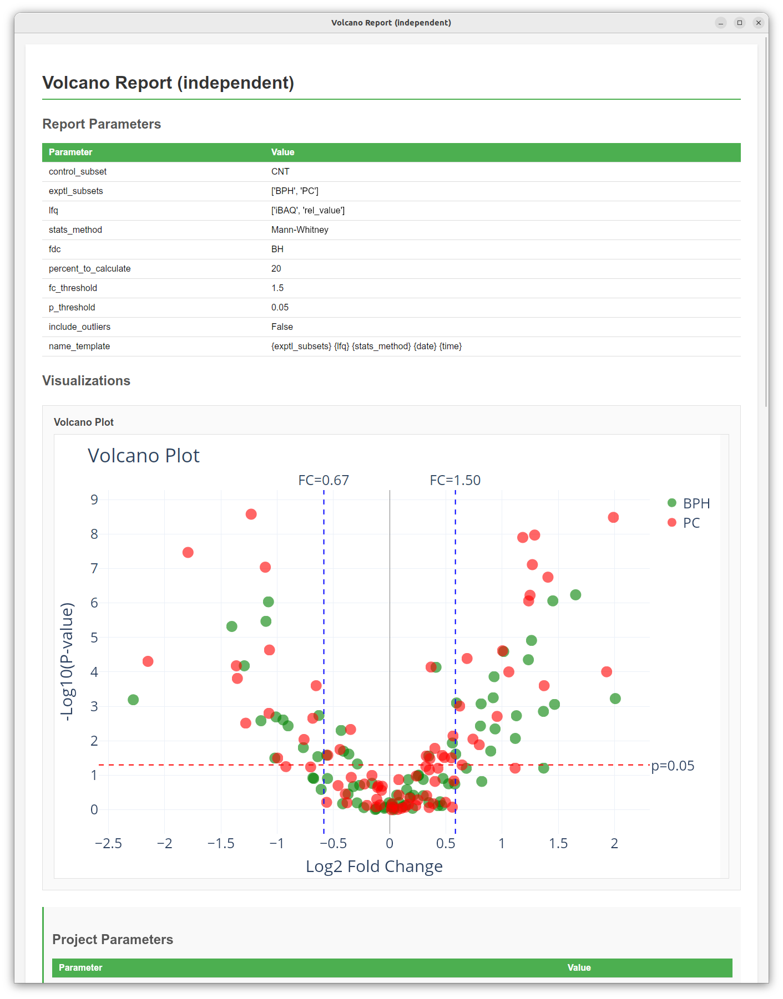

# Reports

The **Reports** tab generates project-wide statistical analyses, cross-tool comparisons, and differential expression visualizations. Each report produces a combination of interactive **Plotly figures** and structured **summary/detail tables** that are saved directly inside your `.dasmix` project file.

Reporting in DASMixer is modular and extensible — in addition to the built-in reports described below, you can install or write custom report plugins (see [Creating Custom Reports](../developer/custom_reports.md)).

{data-description="Reports tab — report list with per-card controls and global settings panel."}

## Global Report Settings and Batch Actions

At the top of the **Reports** tab, the **Report Settings** panel controls default figure dimensions and font styling applied when generating any report:

- **Plot Font Size** (default: `12`) — base font size for axis labels, legends, and annotations
- **Plot Width** (default: `1100` px) — width of generated figures
- **Plot Height** (default: `600` px) — height of generated figures
- **Save** — saves these styling parameters to the project
- **Generate Selected** — runs all reports that have their **Generate with all** checkbox enabled
- **Export All** — exports the most recently generated run of every checked report to a chosen folder

> **Note:** Global plot settings are baked into figures at the moment of generation. Changing font size or dimensions will take effect the next time you click **Generate**.

## Common Controls on Each Report Card

Every report in the list is presented on its own card with a unified set of controls:

- **Generate with all** (checkbox) — includes this report in batch generation/export actions.
- **Parameters** — opens a dialog with report-specific settings (subsets to include, LFQ method, statistical tests, thresholds, etc.).
- **Name format** — a customizable template used to name the generated report run. You can use `{date}` (formatted as `YYMMDD`), `{time}` (`HH:MM`), and any parameter field name from the report (for example, `{subsets} {lfq} {date} {time}`).
- **Generate** — runs the report calculation and saves the resulting plots, tables, and a snapshot of current project/tool settings into the database.
- **Saved Reports** (dropdown) — lists all previously generated runs of this report stored in the project.
- **View** — opens the selected report run in the interactive **Report Viewer** window (or your default web browser, depending on your [Settings](configuration.md)).
- **Export** — exports the selected report run to disk.

## Built-in Reports

Out of the box, DASMixer includes five analytical reports:

### 1. Basic Statistics (`MedianReport`)

Computes comprehensive descriptive statistics of protein abundances across samples and comparison groups.

**Parameters:**

- **Subsets:** Which comparison groups to include (leave all unchecked or select all to include every group).
- **LFQ:** Quantification method (`emPAI`, `iBAQ`, `NSAF`, or `Top3`) and value type (`rel_value`, `abs_value_gl`, or `abs_value_mol`).
- **Include outliers:** Whether to include samples marked as outliers (`False` by default).

**Output:**

- **Basic statistics table:** One row per identified protein with multi-level columns showing:
  - Global occurrence (`Total samples`, `% of all samples`)
  - Per-subset metrics: `Samples`, `% of total samples`, `% of subset_samples`, `Mean`, `Median`, `STD` (standard deviation), `Min`, `Max`, `Variance`, `CV` (coefficient of variation), `Skew`, and `Kurtosis`.

> **Note:** This table is marked as a large background table (`show_in_ui=False`), so it is exported directly to Excel (`.xlsx`) rather than rendered inline in the HTML preview.

---

### 2. PCA & ROC-AUC (`PCAReport`)

Performs Principal Component Analysis (PCA) and Receiver Operating Characteristic (ROC / AUC) analysis on protein quantification profiles to evaluate how well your comparison groups separate.

**Parameters:**

- **Subsets:** Comparison groups to include in the analysis.
- **Group by:**
  - `Sample` (default) — each point on the PCA scatter plot is a **sample**, positioned by its protein abundance profile and colored by comparison group.
  - `Protein` — each point is a `(protein, subset)` pair, built from replicate measurements sorted in descending order, allowing you to inspect protein-level clustering across conditions.
- **LFQ:** Quantification algorithm and value type to analyze.
- **Show labels:** Display sample names (or gene/protein labels) next to scatter points.
- **Top N proteins:** In `Protein` mode, restrict the analysis to the $N$ proteins with the highest variance across samples (default: `100`; set `0` to use all proteins).
- **Include outliers:** Whether to include samples marked as outliers.

**Output:**

- **Plots:**
  - **PCA scatter plot:** 2D projection onto `PC1` and `PC2` with percentage of variance explained on each axis.
  - **ROC / AUC curve:** One-vs-rest ROC curves computed along `PC1` for each comparison group, displaying the Area Under the Curve (AUC).
- **Tables:**
  - **PCA Components** *(shown in preview)*: Explained variance (%) and cumulative variance (%) for up to the first 10 principal components.
  - **AUC by Subset** *(shown in preview)*: One-vs-rest AUC scores per comparison group.
  - **Sample PC Scores / Protein PC Scores** *(exported to Excel)*: Complete table of principal component coordinates.

{data-description="PCA scatter plot and ROC/AUC curve generated by the PCA & ROC-AUC report."}
---

### 3. Volcano Report (Independent) (`VolcanoReport`)

Performs differential expression analysis between a **Control** group and one or more **Experimental** comparison groups for independent samples, computing fold changes and multiple-testing-corrected $p$-values.

**Parameters:**

- **Control subset:** The reference comparison group (denominator for Fold Change).
- **Experimental subsets:** One or more comparison groups to compare against the control group.
- **LFQ:** Quantification algorithm and value type to test.
- **Statistical method:** Two-sample test to compute raw $p$-values:
  - `Mann-Whitney` (non-parametric Mann–Whitney $U$ test, default)
  - `T-test` (independent two-sample Student's $t$-test)
- **FDR / Multiple testing correction (`fdc`):**
  - `BH` — Benjamini–Hochberg False Discovery Rate (default)
  - `BY` — Benjamini–Yekutieli FDR
  - `Bonferroni` — Bonferroni family-wise error rate correction
- **Percent of samples to calculate:** Minimum percentage of samples within a group in which a protein must be quantified to be included in statistical testing (default: `20%`).
- **FC threshold:** Fold Change cutoff for significance lines and Proteins of Interest filtering (default: `1.5`, drawn at $\pm\log_2(\text{FC})$).
- **P-value threshold:** Corrected $p$-value cutoff for statistical significance (default: `0.05`, drawn at $-\log_{10}(p)$).
- **Include outliers:** Whether to include outlier samples.

**Output:**

- **Plots:**
  - **Volcano Plot:** Interactive scatter plot with $\log_2(\text{Fold Change})$ on the X-axis and $-\log_{10}(\text{adjusted } p\text{-value})$ on the Y-axis, colored by experimental group, with dashed threshold lines. Hovering over any point reveals the protein ID, fold change, and $p$-value.
- **Tables (exported to Excel):**
  - **FC table:** Complete results for all tested proteins across all experimental subsets (corrected $p$-value, uncorrected $p$-value, linear FC, $\log_2\text{FC}$, sample counts, and sample percentages).
  - **POI (Proteins of Interest):** Filtered subset of proteins that pass both the $p$-value threshold (`min_pval <= p_threshold`) and Fold Change threshold (`max_fc >= log2(fc_threshold)`).

{data-description="Volcano plot showing log₂(Fold Change) vs. −log₁₀(p-value), with dashed significance thresholds."}

---

### 4. Tool Match (`ToolMatchReport`)

Compares peptide and protein identifications between any two tools in the project, illustrating how much each tool contributes to the final set of preferred identifications.

**Parameters:**

- **Tool 1 / Tool 2:** Select the two identification tools to compare (for example, a database search engine like `MaxQuant` vs. a *de novo* engine like `PowerNovo2`).

**Output:**

- **Plots:**
  - **Occurrence charts:** Side-by-side pie charts showing the breakdown of **Peptide identifications** and **Protein identifications** attributed exclusively to **Tool 1**, exclusively to **Tool 2**, or agreed upon by **Both** tools (highlighted in yellow).
- **Tables:**
  - **Peptide counts & Protein counts** *(shown in preview)*: Summary counts of unique/shared peptides and proteins per tool.
  - **Peptides & Proteins** *(exported to Excel)*: Detailed side-by-side comparison tables listing every spectrum/peptide and protein with metrics from both tools.

---

### 5. UpSet Plot (`UpsetReport`)

Visualizes the overlap and exclusive intersections of identified proteins across comparison groups — an informative alternative to Venn diagrams when comparing two or more groups.

**Parameters:**

- **Subsets:** Which comparison groups to include in the intersection analysis.
- **Min proteins:** Minimum number of proteins required in an intersection for that bar to be drawn on the UpSet plot (default: `1`). Intersections with fewer proteins are hidden from the chart to keep it uncluttered, but remain listed in the summary table.

**Output:**

- **Plots:**
  - **UpSet Plot:** A two-panel figure showing the number of proteins in each exclusive intersection (top bar chart) and a dot-matrix indicating which comparison groups participate in each intersection (bottom panel, with sample counts $N$ shown next to each group name).
- **Tables (shown in preview and exported):**
  - **Intersection Summary:** Number of proteins in every group combination, sorted from largest to smallest.
  - **Proteins by Intersection:** Complete mapping of which `protein_id` belongs to which exclusive group intersection (allowing you to immediately extract group-specific proteins).

---

## Exporting Reports

Clicking **Export** on a report card (or **Export All** at the top of the tab) opens the report export dialog:

{data-description="Report export dialog — choose HTML, DOCX, and/or XLSX output formats."}

Every generated report stores a complete, self-contained snapshot of your analysis:

- **Report parameters** — the exact options used to generate that run
- **Project and tool parameters** — ion matching settings, protein detection rules, LFQ parameters, and per-tool quality thresholds active at the moment of generation
- **Interactive plots** — Plotly figures
- **Small summary tables** — displayed directly inside the report preview and documents (`show_in_ui=True`)
- **Large detail tables** — comprehensive data tables designed for spreadsheet analysis (`show_in_ui=False`)

You can export a report in up to three formats simultaneously:

| Format | Description |
|---|---|
| **HTML** | A standalone, interactive web page embedding Plotly.js, all interactive charts, small summary tables, and collapsible parameter snapshots. Can be opened in any modern browser. |
| **DOCX** | A Microsoft Word document containing static high-resolution PNG renderings of all plots, summary tables, and recorded parameters — ready to paste or adapt into a manuscript. |
| **XLSX** | A Microsoft Excel workbook containing one sheet per table. You can choose between **All tables** (both summary and large detail tables) or **Large tables only** (only full data tables that are omitted from the HTML/DOCX document). |

Exported files are named automatically using the pattern `{Report Name}_{Display Name}.{ext}` (with filesystem-unsafe characters such as `:` replaced by `-`).
