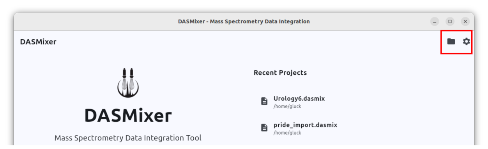
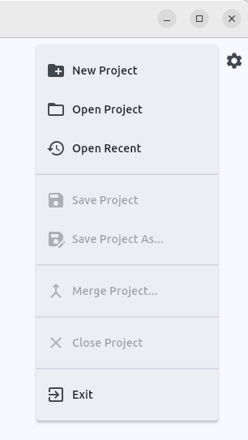
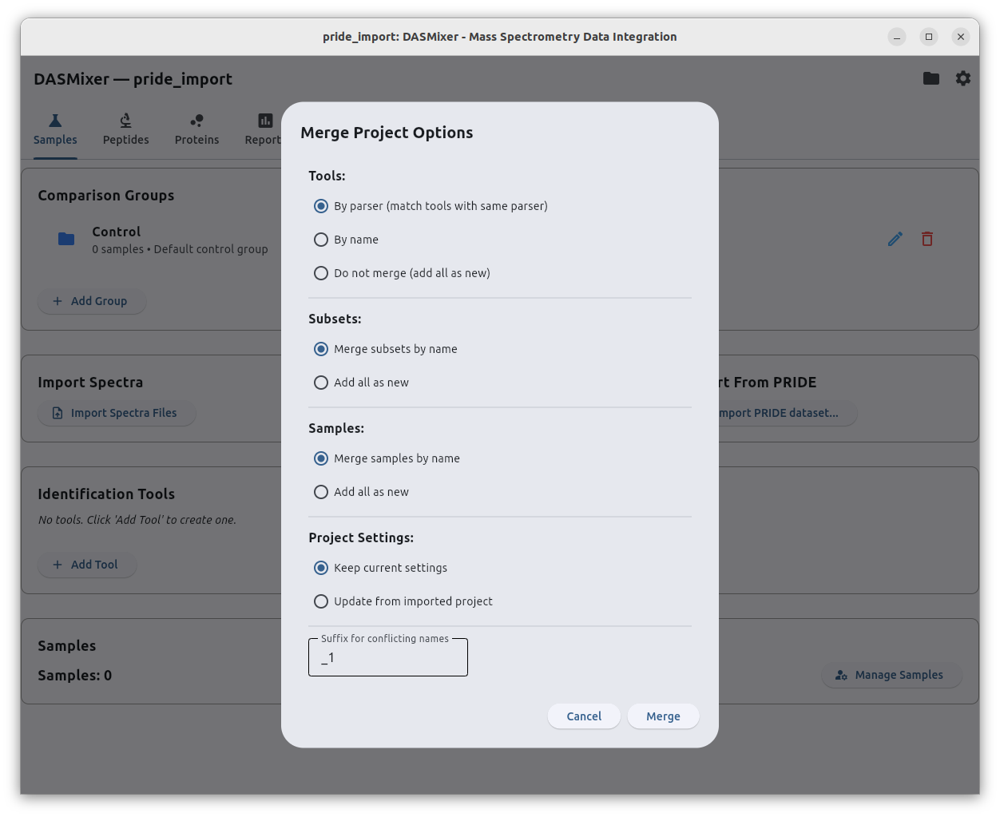
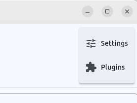

# System Menus (File & Options)

The top application bar (**AppBar**) is visible across all screens in DASMixer — both on the initial Start screen and inside an open project workspace. On the left, it displays the application title along with the name of the currently open `.dasmix` project. On the right, two system menu buttons provide access to project lifecycle operations, project merging, global preferences, and plugin management:

- **File menu** (folder icon) — create, open, save, merge, or close projects, and exit the application.
- **Options menu** (gear icon) — configure application-wide settings and manage external plugins.

{data-description="The AppBar at the top of the DASMixer window — project name on the left, File and Options menu icons on the right."}

---

## File Menu

**{data-description="File menu items — New, Open, Open Recent, Save, Save As, Merge, Close, Exit."}**

The **File** menu manages `.dasmix` project files. When no project is open (on the Start screen), project-specific actions (*Save*, *Save As*, *Merge*, and *Close*) are automatically disabled.

### 1. New Project

Opens a system file dialog where you can choose the destination folder and filename for a new `.dasmix` project. Once created, DASMixer initializes the database with a default **Control** comparison group and opens the main workspace on the **Samples** tab.

See [Getting Started: Projects and Samples — Creating a Project](project_sample.md#creating-a-project) for details on disk space requirements and initial project setup.

### 2. Open Project

Opens a file picker filtered to `*.dasmix` files. If another project is currently open, DASMixer cleanly closes it before loading the selected file.

#### Automatic Version Check and Schema Migration

When opening an existing project, DASMixer checks the internal database schema version (`PROJECT_VERSION`) stored in the file:

- **Older project version:** If the project was created with an earlier version of DASMixer, a **Project Update Required** dialog appears offering to migrate the database schema to the current version. Because project files can be several gigabytes in size, we recommend keeping a backup copy before confirming **Update**.
- **Newer project version:** If the project was created by a newer release of DASMixer than the one currently running, an **Incompatible Project Version** warning is displayed, recommending that you update your DASMixer installation to avoid unexpected errors.

### 3. Open Recent

Opens the **Open Recent Project** modal dialog, displaying up to 10 recently opened or created `.dasmix` files with their filenames and parent directories (any files that have been moved or deleted from disk are filtered out automatically).

Clicking a project in the list:

1. Automatically saves and checkpoints the currently open project (if any),
2. Closes the current project, and
3. Opens the selected project (running the schema version check if needed).

### 4. Save Project

Explicitly commits all pending database changes and performs a full SQLite Write-Ahead Log (`WAL`) checkpoint.

> **Why use Save Project before copying a file?** While DASMixer continuously writes data to the project database during imports and calculations, SQLite in WAL mode temporarily holds recent transactions in companion `-wal` and `-shm` files alongside the `.dasmix` file. Clicking **File → Save Project** flushes all WAL pages directly into the main `.dasmix` file so you can safely copy, back up, or share the file while the project is still open. (Closing a project or exiting DASMixer also performs this checkpoint automatically.)

### 5. Save Project As…

Prompts for a new `.dasmix` file path and writes a complete, self-contained copy of the currently open project to the new location, adding the new file to your **Recent Projects** list.

### 6. Merge Project…

Imports and merges data from another `.dasmix` project file into the currently open project. This is particularly useful when combining batches of samples processed on different computers or merging separate experimental runs into a unified comparative study.

> **Schema Version Requirement:** Both the source project and the currently open target project must share the same internal `PROJECT_VERSION`. If the project you want to merge was created in an older version of DASMixer, open it directly via **File → Open Project** first, accept the migration prompt, close it, and then run **Merge Project…**.

After you select the source `.dasmix` file, the **Merge Project Options** dialog opens:

{data-description="Merge Project Options dialog — control how tools, subsets, samples, and settings are reconciled."}

You can configure how entities from the imported project are matched against your current project:

- **Tools:**
  - *By parser (match tools with same parser)* *(default)* — merges imported tools with existing tools that use the same parser (e.g., `PowerNovo2` or `MaxQuant`), combining their identifications under the existing tool.
  - *By name* — merges tools only when their display names match exactly.
  - *Do not merge (add all as new)* — creates separate tool entries for every tool in the imported project.
- **Subsets (Comparison Groups):**
  - *Merge subsets by name* *(default)* — maps imported comparison groups to existing groups with the same name (e.g., `Control`).
  - *Add all as new* — creates new comparison groups for all imported subsets.
- **Samples:**
  - *Merge samples by name* *(default)* — merges spectra and identification files into existing samples when sample names match.
  - *Add all as new* — imports every sample as a separate entry even if a sample with the same name already exists.
- **Project Settings:**
  - *Keep current settings* *(default)* — preserves the target project's ion matching, FASTA, and LFQ parameters.
  - *Update from imported project* — overwrites project-level settings with values from the imported file.
- **Suffix for conflicting names** (default: `_1`): When entities are added as new (or cannot be merged) and their name collides with an existing tool, subset, or sample, DASMixer appends this suffix to keep names unique.

Click **Merge** to start the import. A progress dialog tracks each database table as spectra, identifications, peptide matches, proteins, LFQ results, saved plots, and generated reports are transferred and re-indexed into the current project.

> **Automating merges:** The same project merge functionality is also available from the command line via [`dasmixer-cli import-project`](advanced/cli.md#6-merging-projects-import-project) and through the Python API (`project.import_project(...)`).

### 7. Close Project

Saves and closes the currently open `.dasmix` database connection and returns to the Start screen.

### 8. Exit

Performs a graceful application shutdown:

1. Commits and closes the currently open project database (if any),
2. Terminates any open child windows (such as interactive Plotly or Report Viewer windows), and
3. Closes the main DASMixer window.

*(Clicking the native operating system window close button `×` performs the exact same graceful shutdown sequence.)*

---

## Options Menu

The **Options** menu (gear icon) is always active: both on the Start screen and while working inside a project. Selecting an item opens a dedicated view on top of your current screen; use the back arrow (`←`) in the top-left corner of the bar to return to your project or Start screen.

{data-description="Options menu items — Settings and Plugins."}

### 1. Settings

Opens the **Application Settings** view, where you can configure preferences that apply across all projects:

- **Appearance** — switch between Light and Dark themes, select the default plot aspect ratio (`16:9`, `4:3`, `1:1`, `2:3`), and choose whether interactive plots and reports open in an embedded desktop **Window** (PyWebView) or your system **Browser**.
- **Batch Operation Limits** — tune database and multiprocessing chunk sizes for spectra import, identification import, ion coverage calculation, and BLAST protein mapping.
- **Processing** — cap the maximum number of CPU worker threads (`Max CPU Threads`).
- **Temporary Files** — configure and clean up directories used for HTML plot previews and large file conversions (MaxQuant `.apl` and PRIDE downloads).
- **Logging** — enable file logging, adjust log verbosity (`DEBUG`, `INFO`, `WARNING`, `ERROR`), and toggle per-worker log files.
- **Default Color Palette** — customize the hex colors automatically assigned to new comparison groups and tools.

For a complete explanation of every setting and platform-specific configuration paths, see [Settings and Plugins — Application Settings](configuration.md#application-settings-options-settings).

### 2. Plugins

Opens the **Plugins** management view, where you can:

- Inspect all built-in and externally installed **Identification Parsers** and **Reports**
- Enable, disable, or uninstall external plugins
- Install new `.py` or `.zip` plugins directly from disk via **Install from file…**
- Open the platform plugins directory in your system file manager

For full details on installing and managing plugins, see [Settings and Plugins — Managing Plugins](configuration.md#managing-plugins-options-plugins). To write your own plugin, refer to [Custom Identification Importers](../developer/custom_importers.md) and [Custom Reports](../developer/custom_reports.md).
